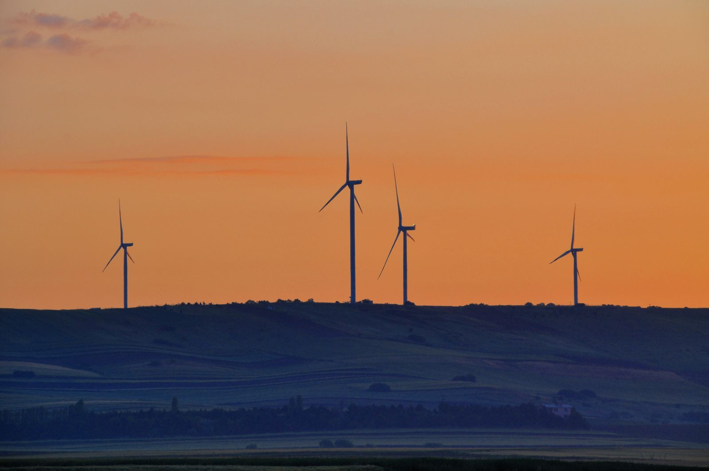

# Прогноз выработки ветропарка

ЭнергоМозаика / Data Science

## Контекст

Диспетчеру нужен прогноз на сутки с объяснением неопределённости.

## Задача

Ноутбук, базовая модель и график ошибок по часам.

## Входные материалы

Подготовленная выборка и словарь полей. Для нескольких задач есть малые примеры в documents/sample-inputs; полный набор для конкретного задания согласуется до старта. Доступ к реальным системам не требуется.

## Границы MVP

Один основной пользовательский сценарий и обработка ошибочного ввода. Работа ведётся на отдельном стенде; промышленный запуск оценивается следующим этапом.

## Критерии приёмки

Обучение отделено по времени; есть сравнение с прогнозом «как вчера».

Команда прикладывает инструкцию воспроизведения, описание ограничений и результаты проверок. Демонстрация занимает 10 минут, после неё предусмотрены вопросы наставника и одна итерация доработок.

## Материалы

[Постановка задачи PDF](../documents/briefs/syn_case_009.pdf)

Ноутбук, базовая модель и график ошибок по часам. Инструкция воспроизведения и отчёт о проверках обязательны.
