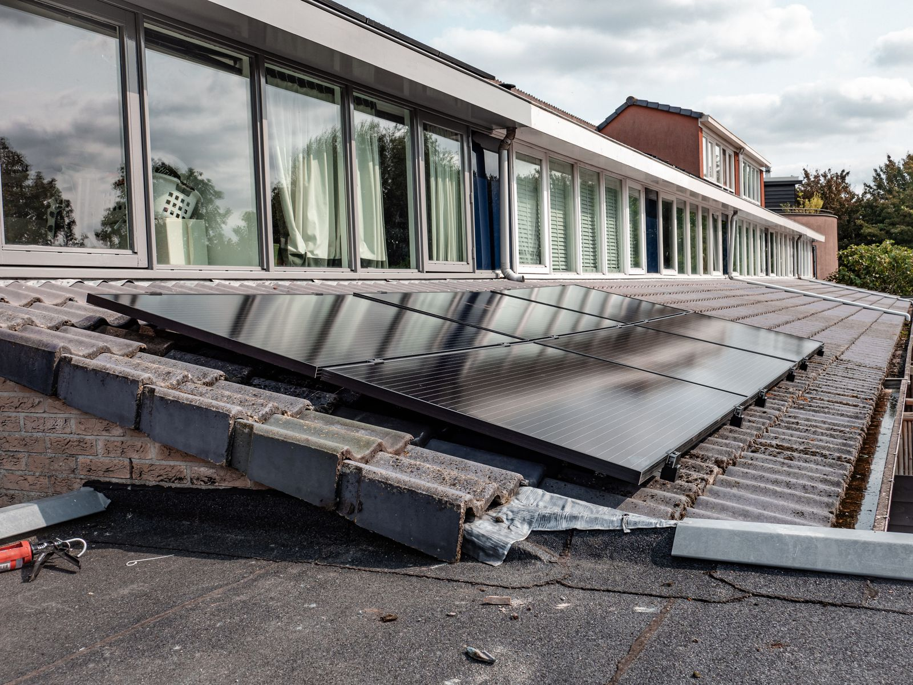

# Учёт потерь солнечной станции

ЭнергоМозаика / Data Science

## Контекст

Плановая и фактическая генерация используют разные часовые пояса.

## Задача

Отчёт о потерях с приведением времени и отметками обслуживания.

## Входные материалы

Подготовленная выборка и словарь полей. Для нескольких задач есть малые примеры в documents/sample-inputs; полный набор для конкретного задания согласуется до старта. Доступ к реальным системам не требуется.

## Границы MVP

Один основной пользовательский сценарий и обработка ошибочного ввода. Работа ведётся на отдельном стенде; промышленный запуск оценивается следующим этапом.

## Критерии приёмки

Ночь не считается аварией; смена даты не теряет измерения.

Команда прикладывает инструкцию воспроизведения, описание ограничений и результаты проверок. Демонстрация занимает 10 минут, после неё предусмотрены вопросы наставника и одна итерация доработок.

## Материалы

[Постановка задачи PDF](../documents/briefs/syn_case_010.pdf)

Отчёт о потерях с приведением времени и отметками обслуживания. Инструкция воспроизведения и отчёт о проверках обязательны.
