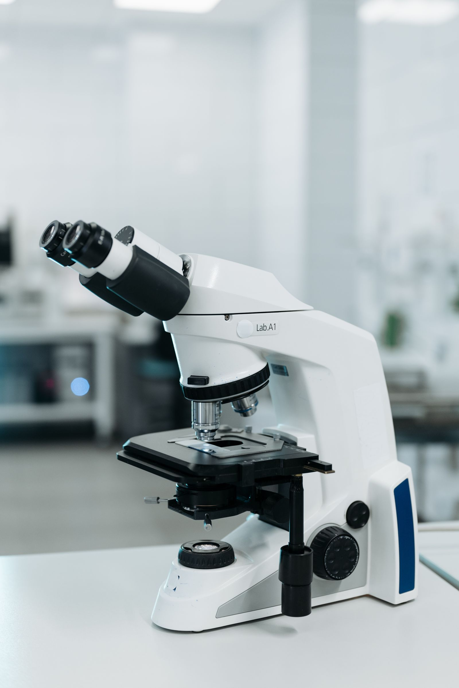

# Качество воды на учебном стенде

АкваКонтекст / IoT

## Контекст

Измерения pH и температуры поступают с пропусками и разными единицами.

## Задача

Панель с единицами, калибровкой и журналом предупреждений.

## Входные материалы

Подготовленная выборка и словарь полей. Для нескольких задач есть малые примеры в documents/sample-inputs; полный набор для конкретного задания согласуется до старта. Доступ к реальным системам не требуется.

## Границы MVP

Один основной пользовательский сценарий и обработка ошибочного ввода. Работа ведётся на отдельном стенде; промышленный запуск оценивается следующим этапом.

## Критерии приёмки

Невалидное показание не усредняется; результат не называется санитарным заключением.

Команда прикладывает инструкцию воспроизведения, описание ограничений и результаты проверок. Демонстрация занимает 10 минут, после неё предусмотрены вопросы наставника и одна итерация доработок.

## Материалы

[Постановка задачи PDF](../documents/briefs/syn_case_013.pdf)

Панель с единицами, калибровкой и журналом предупреждений. Инструкция воспроизведения и отчёт о проверках обязательны.
