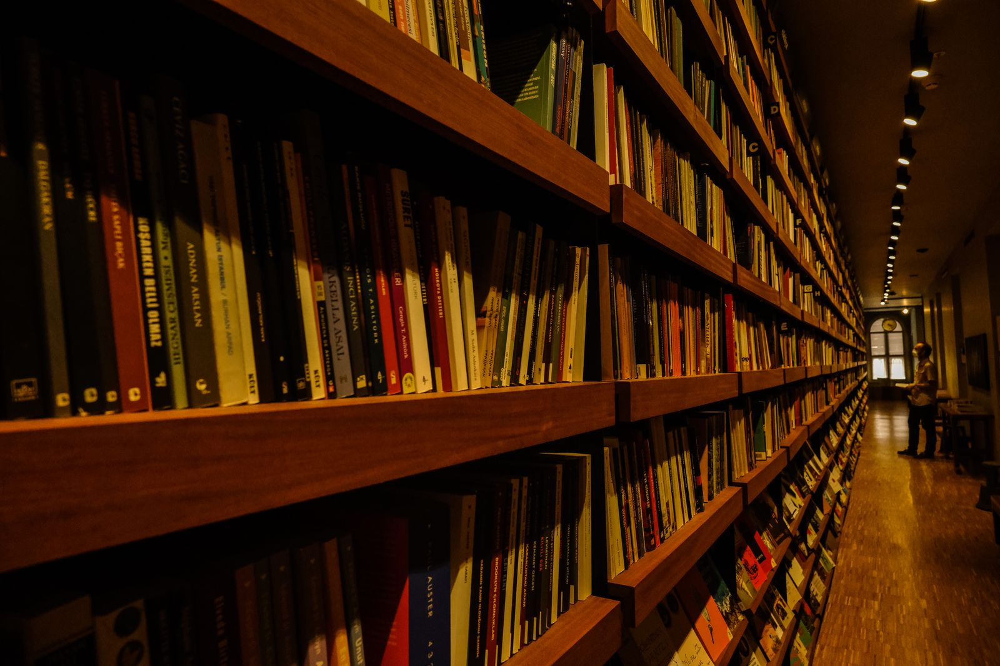

# Выравнивание архивных сканов

Архивный Луч / Компьютерное зрение

## Контекст

Страницы сняты под углом, распознавание теряет строки.

## Задача

Конвейер выравнивания с просмотром до и после.

## Входные материалы

Подготовленная выборка и словарь полей. Для нескольких задач есть малые примеры в documents/sample-inputs; полный набор для конкретного задания согласуется до старта. Доступ к реальным системам не требуется.

## Границы MVP

Один основной пользовательский сценарий и обработка ошибочного ввода. Работа ведётся на отдельном стенде; промышленный запуск оценивается следующим этапом.

## Критерии приёмки

Заметки на полях не обрезаны; сложные кадры отправляются на ручную проверку.

Команда прикладывает инструкцию воспроизведения, описание ограничений и результаты проверок. Демонстрация занимает 10 минут, после неё предусмотрены вопросы наставника и одна итерация доработок.

## Материалы

[Постановка задачи PDF](../documents/briefs/syn_case_019.pdf)

Конвейер выравнивания с просмотром до и после. Инструкция воспроизведения и отчёт о проверках обязательны.
