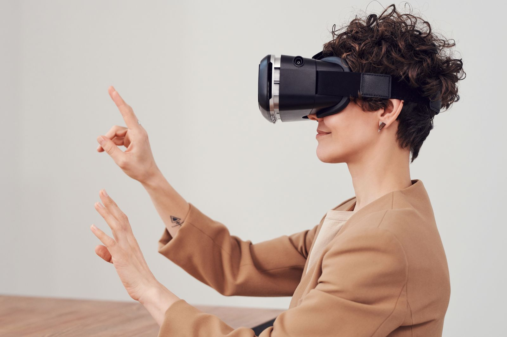

# Виртуальная витрина экспоната

Музейный Слой / AR/VR

## Контекст

Небольшая деталь экспоната не видна за стеклом.

## Задача

3D-просмотр с подписями и облегчённой версией.

## Входные материалы

Подготовленная выборка и словарь полей. Для нескольких задач есть малые примеры в documents/sample-inputs; полный набор для конкретного задания согласуется до старта. Доступ к реальным системам не требуется.

## Границы MVP

Один основной пользовательский сценарий и обработка ошибочного ввода. Работа ведётся на отдельном стенде; промышленный запуск оценивается следующим этапом.

## Критерии приёмки

Доступно управление без жестов; происхождение модели указано.

Команда прикладывает инструкцию воспроизведения, описание ограничений и результаты проверок. Демонстрация занимает 10 минут, после неё предусмотрены вопросы наставника и одна итерация доработок.

## Материалы

[Постановка задачи PDF](../documents/briefs/syn_case_035.pdf)

3D-просмотр с подписями и облегчённой версией. Инструкция воспроизведения и отчёт о проверках обязательны.
