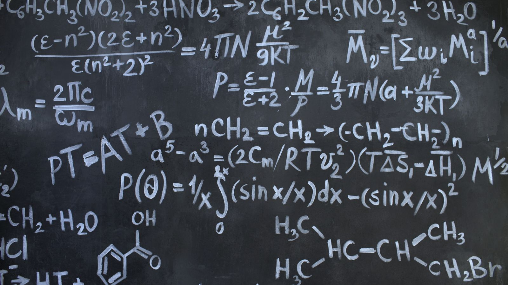

# Балансировка учебных команд

Дискретный План / Математика

## Контекст

Студенты имеют разные навыки и доступное время.

## Задача

Алгоритм формирования команд с прозрачной оценкой.

## Входные материалы

Подготовленная выборка и словарь полей. Для нескольких задач есть малые примеры в documents/sample-inputs; полный набор для конкретного задания согласуется до старта. Доступ к реальным системам не требуется.

## Границы MVP

Один основной пользовательский сценарий и обработка ошибочного ввода. Работа ведётся на отдельном стенде; промышленный запуск оценивается следующим этапом.

## Критерии приёмки

Пожелания не обещаются как гарантии; дефицит навыков объяснён.

Команда прикладывает инструкцию воспроизведения, описание ограничений и результаты проверок. Демонстрация занимает 10 минут, после неё предусмотрены вопросы наставника и одна итерация доработок.

## Материалы

[Постановка задачи PDF](../documents/briefs/syn_case_048.pdf)

Алгоритм формирования команд с прозрачной оценкой. Инструкция воспроизведения и отчёт о проверках обязательны.
