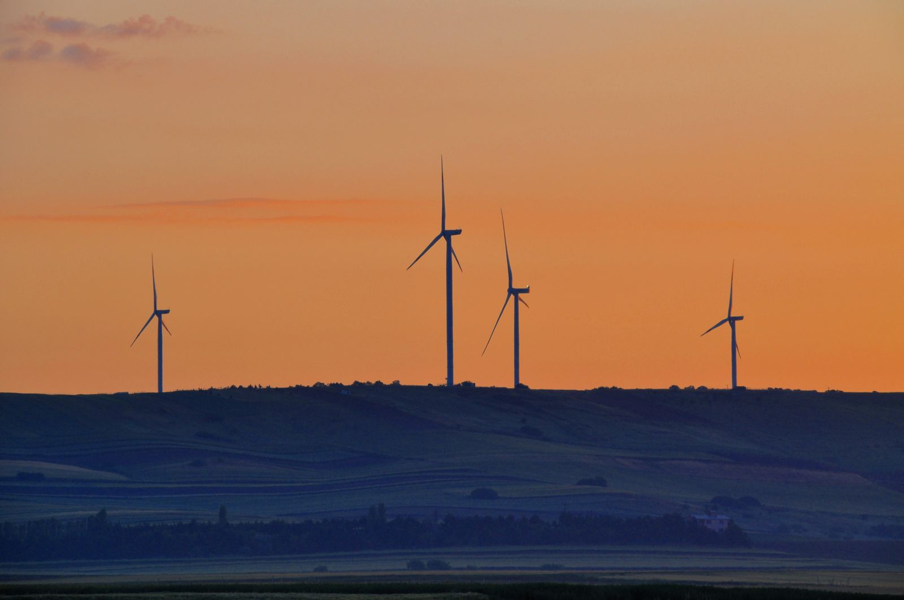

# Стажировка: data science — ЭнергоМозаика

ЭнергоМозаика / Data Science

## Направление

Возобновляемая энергетика.

## Задача

Ноутбук, базовая модель и график ошибок по часам.

## Входные знания

Python, pandas; умение объяснить свой вклад.

## Организация

8 недель, 16 часов в неделю. Один разбор с наставником в неделю. Смешанный формат; место встреч будет согласовано отдельно.

## Итог

Обучение отделено по времени; есть сравнение с прогнозом «как вчера».

## Отбор

Описание учебного проекта и знакомство с наставником. Коммерческий опыт не требуется.

## Итоговая защита

Короткая демонстрация, разбор проверок и обсуждение дальнейшего развития решения.

## Материалы

[Постановка задачи PDF](../documents/briefs/syn_internship_case_003.pdf)

Ноутбук, базовая модель и график ошибок по часам. Отчёт о проверках и личном вкладе.
