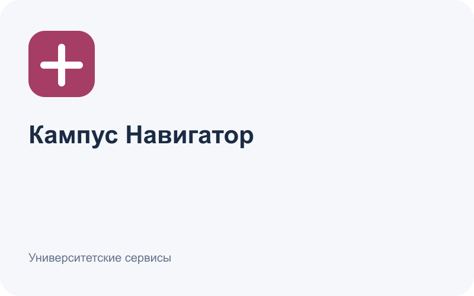

# Кампус Навигатор

Команда в области «Университетские сервисы». Предлагает студентам задачи «Календарь консультаций» и «Поиск свободных аудиторий». Работа с подготовленными наборами данных с еженедельным разбором решений.

## Направления

Frontend

[Карточка компании PDF](../documents/companies/syn_company_006.pdf)

## Задания

- [Календарь консультаций](../cases/syn_case_011.md)
- [Поиск свободных аудиторий](../cases/syn_case_012.md)
- [Кладовая лаборатории](../cases/syn_extra_case_002.md)
- [Ключи в журнале](../cases/syn_extra_case_010.md)
- [Кампус за 36 часов](../cases/syn_hackathon_001.md)
