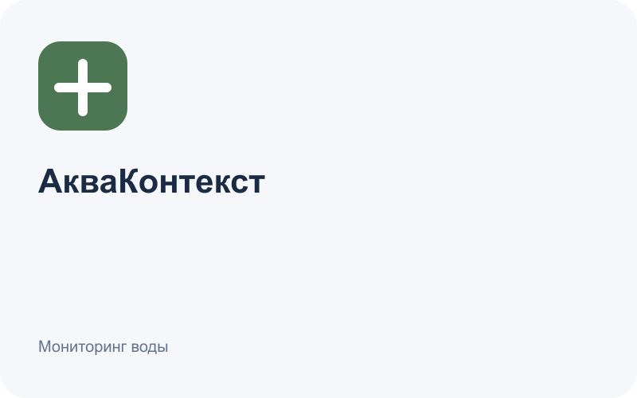

# АкваКонтекст

Команда в области «Мониторинг воды». Предлагает студентам задачи «Качество воды на учебном стенде» и «Журнал отбора проб». Работа с подготовленными наборами данных с еженедельным разбором решений.

## Направления

IoT

[Карточка компании PDF](../documents/companies/syn_company_007.pdf)

## Задания

- [Качество воды на учебном стенде](../cases/syn_case_013.md)
- [Журнал отбора проб](../cases/syn_case_014.md)
- [Город видит данные](../cases/syn_hackathon_002.md)
- [Стажировка: iot — АкваКонтекст](../cases/syn_internship_case_004.md)
