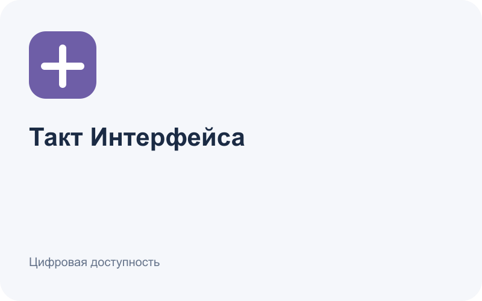

# Такт Интерфейса

Команда в области «Цифровая доступность». Предлагает студентам задачи «Доступная форма обращения» и «Онбординг без перегрузки». Работа с подготовленными наборами данных с еженедельным разбором решений.

## Направления

UX/UI

[Карточка компании PDF](../documents/companies/syn_company_008.pdf)

## Задания

- [Доступная форма обращения](../cases/syn_case_015.md)
- [Онбординг без перегрузки](../cases/syn_case_016.md)
