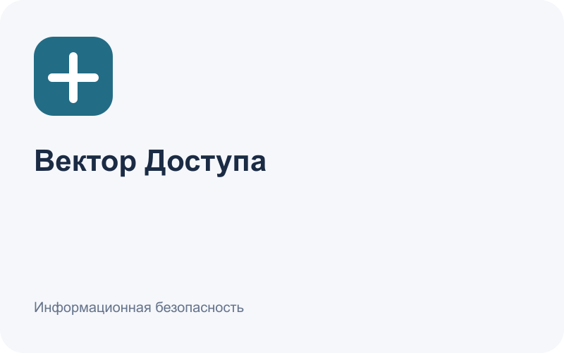

# Вектор Доступа

Команда в области «Информационная безопасность». Предлагает студентам задачи «Матрица прав учебного API» и «Жизненный цикл сессий». Работа с подготовленными наборами данных с еженедельным разбором решений.

## Направления

Информационная безопасность

[Карточка компании PDF](../documents/companies/syn_company_009.pdf)

## Задания

- [Матрица прав учебного API](../cases/syn_case_017.md)
- [Жизненный цикл сессий](../cases/syn_case_018.md)
- [Честная очередь на GPU](../cases/syn_extra_case_003.md)
- [Тур по лаборатории](../cases/syn_extra_case_011.md)
- [Стажировка: информационная безопасность — Вектор Доступа](../cases/syn_internship_case_005.md)
