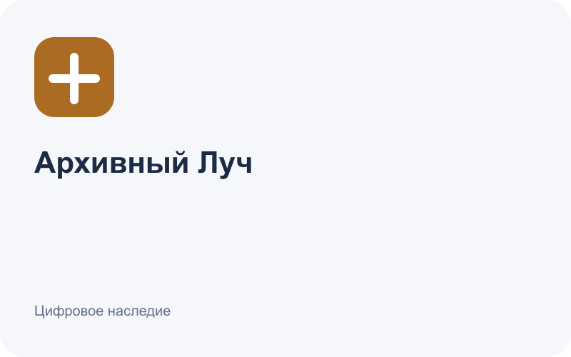

# Архивный Луч

Команда в области «Цифровое наследие». Предлагает студентам задачи «Выравнивание архивных сканов» и «Разметка рукописных карточек». Работа с подготовленными наборами данных с еженедельным разбором решений.

## Направления

Компьютерное зрение

[Карточка компании PDF](../documents/companies/syn_company_010.pdf)

## Задания

- [Выравнивание архивных сканов](../cases/syn_case_019.md)
- [Разметка рукописных карточек](../cases/syn_case_020.md)
