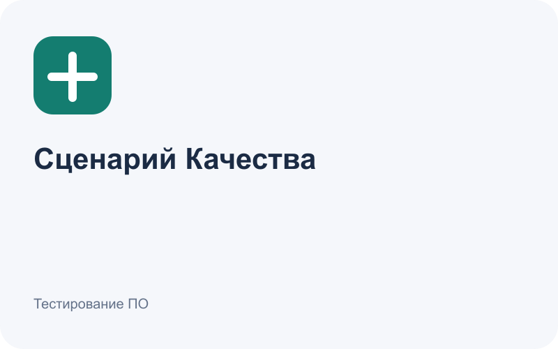

# Сценарий Качества

Команда в области «Тестирование ПО». Предлагает студентам задачи «Проверки корзины учебного магазина» и «Тестирование импорта таблиц». Работа с подготовленными наборами данных с еженедельным разбором решений.

## Направления

Тестирование

[Карточка компании PDF](../documents/companies/syn_company_014.pdf)

## Задания

- [Проверки корзины учебного магазина](../cases/syn_case_027.md)
- [Тестирование импорта таблиц](../cases/syn_case_028.md)
- [Качество API: найди граничный случай](../cases/syn_olympiad_003.md)
