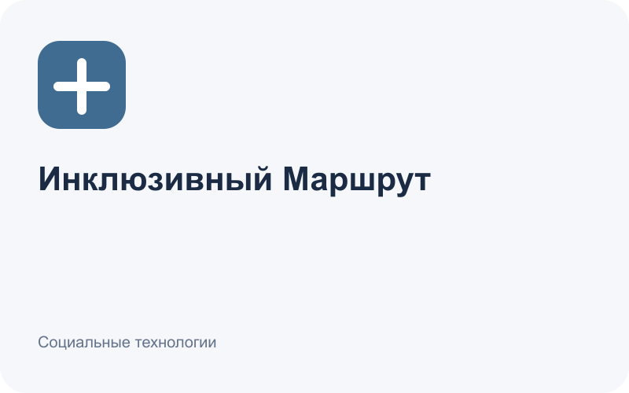

# Инклюзивный Маршрут

Команда в области «Социальные технологии». Предлагает студентам задачи «Сопровождение посетителя» и «Доступная навигация в здании». Работа с подготовленными наборами данных с еженедельным разбором решений.

## Направления

Системный анализ

[Карточка компании PDF](../documents/companies/syn_company_017.pdf)

## Задания

- [Сопровождение посетителя](../cases/syn_case_033.md)
- [Доступная навигация в здании](../cases/syn_case_034.md)
