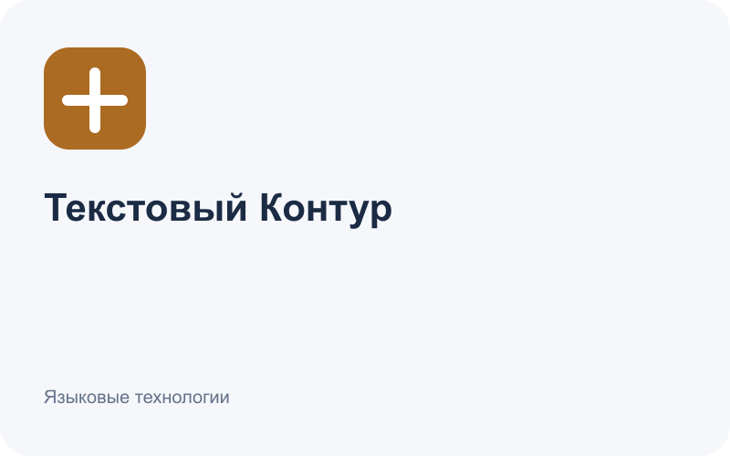

# Текстовый Контур

Команда в области «Языковые технологии». Предлагает студентам задачи «Поиск по учебной базе знаний» и «Рубрикатор обращений». Работа с подготовленными наборами данных с еженедельным разбором решений.

## Направления

Искусственный интеллект

[Карточка компании PDF](../documents/companies/syn_company_022.pdf)

## Задания

- [Поиск по учебной базе знаний](../cases/syn_case_043.md)
- [Рубрикатор обращений](../cases/syn_case_044.md)
