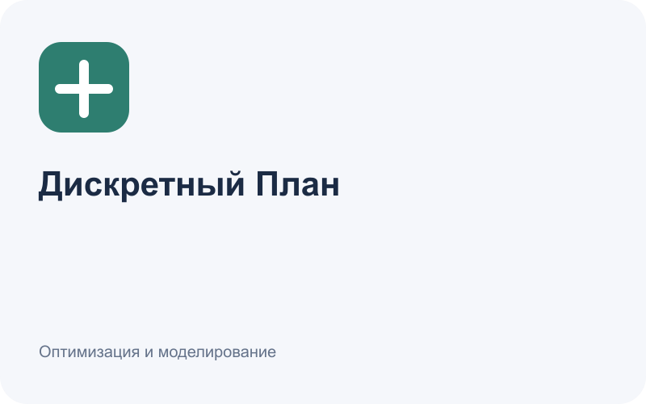

# Дискретный План

Команда в области «Оптимизация и моделирование». Предлагает студентам задачи «Распределение лабораторных смен» и «Балансировка учебных команд». Работа с подготовленными наборами данных с еженедельным разбором решений.

## Направления

Математика

[Карточка компании PDF](../documents/companies/syn_company_024.pdf)

## Задания

- [Распределение лабораторных смен](../cases/syn_case_047.md)
- [Балансировка учебных команд](../cases/syn_case_048.md)
- [Ремонт по заявке](../cases/syn_extra_case_008.md)
- [Алгоритм и доказательство](../cases/syn_olympiad_002.md)
