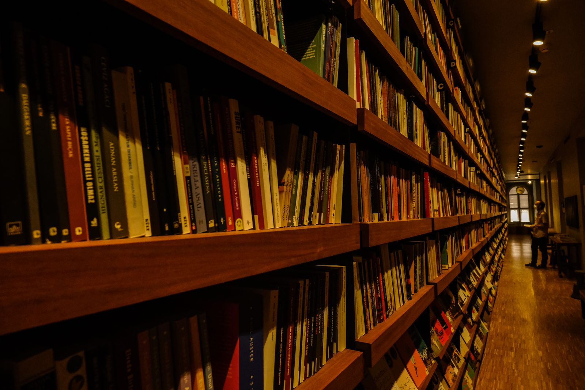

# Практика: компьютерное зрение — Архивный Луч

## Направление

Цифровое наследие. 

## Задача

Конвейер выравнивания с просмотром до и после.

## Входные знания

Python, OpenCV; умение объяснить свой вклад.

## Организация

6 недель, 12 часов в неделю. Один разбор с наставником в неделю. Дистанционный формат.

## Итог

Заметки на полях не обрезаны; сложные кадры отправляются на ручную проверку.

## Отбор

Описание учебного проекта и знакомство с наставником. Коммерческий опыт не требуется.

## Итоговая защита

Короткая демонстрация, разбор проверок и обсуждение дальнейшего развития решения.
