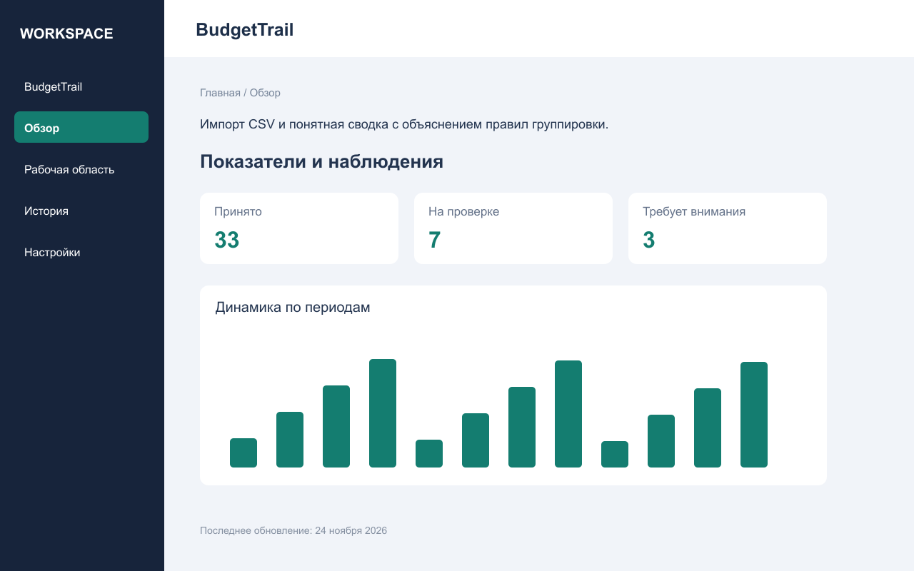
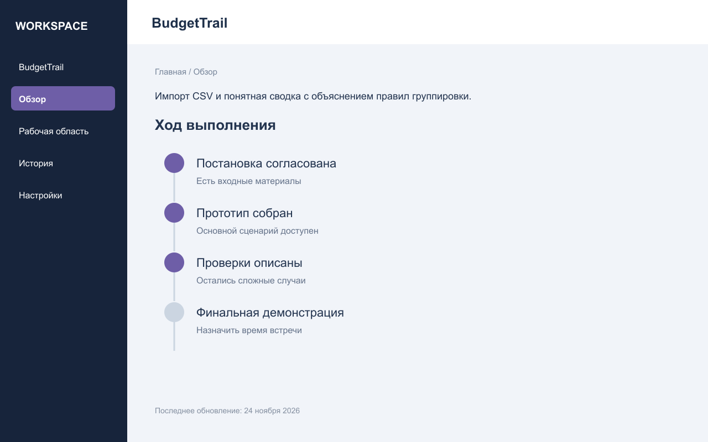

# BudgetTrail

Руслан Хакимов Алексеевич / Data Science

## Зачем

Выгрузка расходов содержит разные категории и возвраты.

## Что делает

Импорт CSV и понятная сводка с объяснением правил группировки.

## Личный вклад

профилирование входа, контрольные расчёты и визуализация.

## Что проверено

Пустые данные, повтор действия, сохранение состояния и восстановление после перезапуска.

## Следующий шаг

Собрать наблюдения пользователей и сократить лишние действия.

## Изображения интерфейса

[Портфолио PDF](../documents/portfolios/syn_petproject_003.pdf) / [Презентация PDF](../documents/presentations/syn_petproject_003.pdf)
