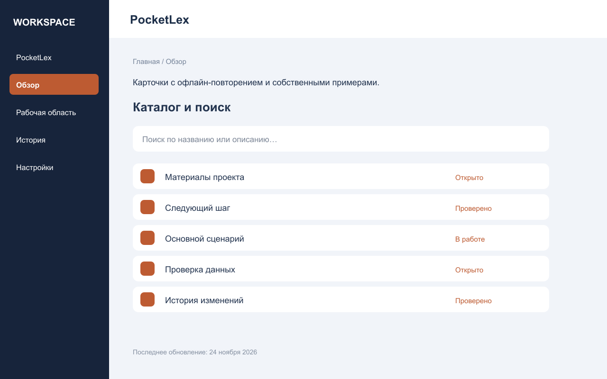
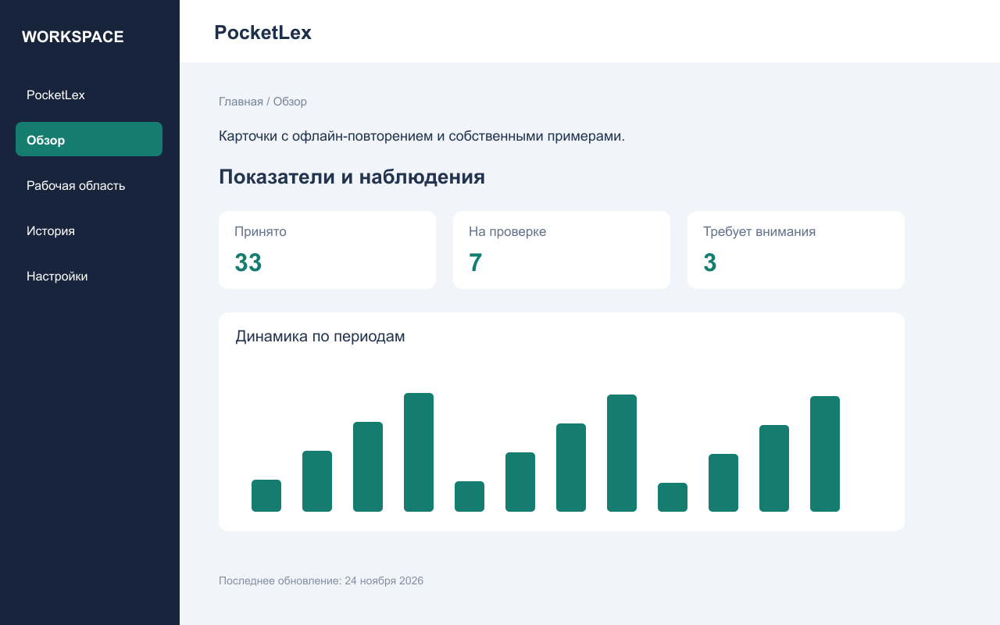

# PocketLex

Екатерина Морозова Андреевна / Мобильная разработка

## Зачем

Новые слова забываются, если повторять их без интервалов.

## Что делает

Карточки с офлайн-повторением и собственными примерами.

## Личный вклад

карта пути пользователя, прототипы и библиотека состояний.

## Что проверено

Пустые данные, повтор действия, сохранение состояния и восстановление после перезапуска.

## Следующий шаг

Измерить время обработки на увеличенном входе.

## Изображения интерфейса

[Портфолио PDF](../documents/portfolios/syn_petproject_004.pdf) / [Презентация PDF](../documents/presentations/syn_petproject_004.pdf)
