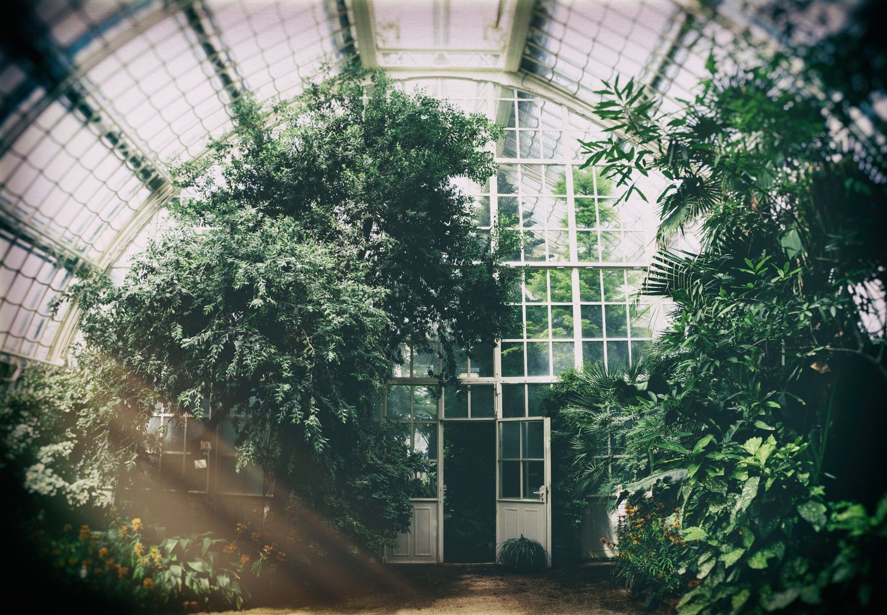
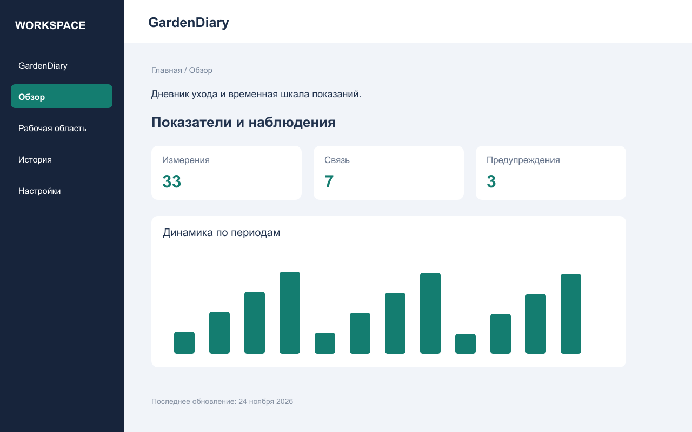
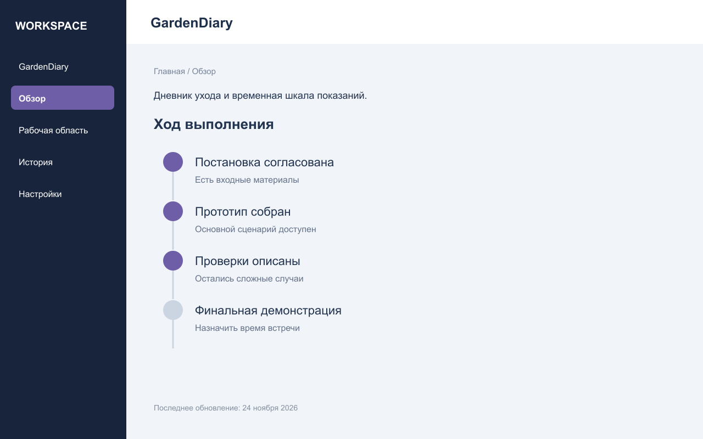

# GardenDiary

Никита Фёдоров Алексеевич / IoT

## Зачем

Заметки о растениях не связаны с измерениями освещения.

## Что делает

Дневник ухода и временная шкала показаний.

## Личный вклад

тест-дизайн, автоматизация и отчёты о дефектах.

## Что проверено

Пустые данные, повтор действия, сохранение состояния и восстановление после перезапуска.

## Следующий шаг

Проверить сценарий на мобильном экране и улучшить навигацию.

## Изображения интерфейса

[Портфолио PDF](../documents/portfolios/syn_petproject_005.pdf) / [Презентация PDF](../documents/presentations/syn_petproject_005.pdf)
