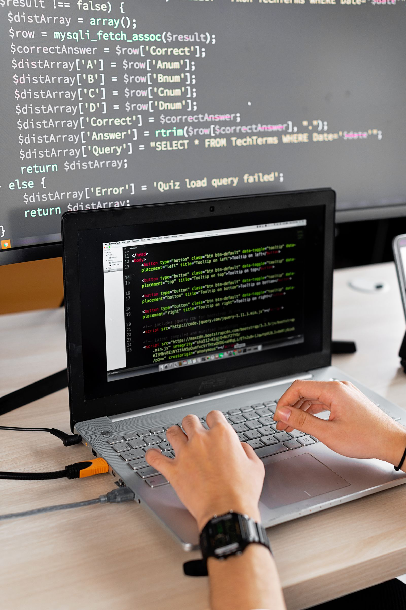
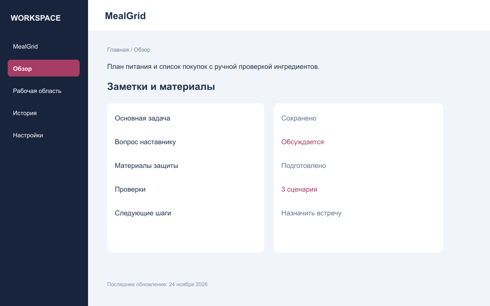
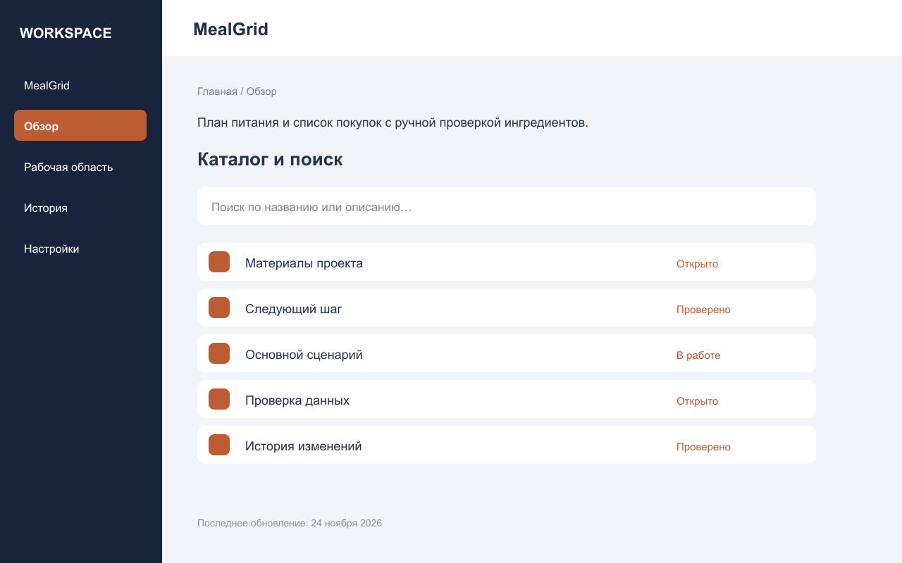

# MealGrid

Алина Иванова Андреевна / UX/UI

## Зачем

Трудно спланировать меню, учитывая уже купленные продукты.

## Что делает

План питания и список покупок с ручной проверкой ингредиентов.

## Личный вклад

подготовка выборки, оценка ошибок и сервис предсказаний.

## Что проверено

Пустые данные, повтор действия, сохранение состояния и восстановление после перезапуска.

## Следующий шаг

Добавить импорт и экспорт с понятным отчётом об ошибках.

## Изображения интерфейса

[Портфолио PDF](../documents/portfolios/syn_petproject_006.pdf) / [Презентация PDF](../documents/presentations/syn_petproject_006.pdf)
