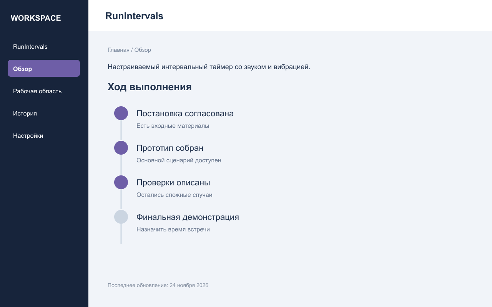
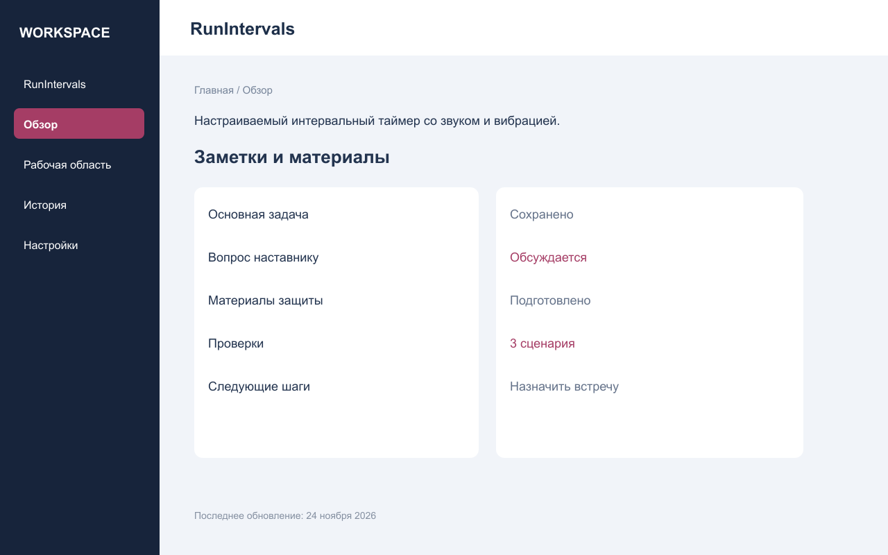

# RunIntervals

Илья Новиков Алексеевич / Мобильная разработка

## Зачем

Во время тренировки неудобно переключать таймеры вручную.

## Что делает

Настраиваемый интервальный таймер со звуком и вибрацией.

## Личный вклад

окружение, журналы, панели и инструкция восстановления.

## Что проверено

Пустые данные, повтор действия, сохранение состояния и восстановление после перезапуска.

## Следующий шаг

Собрать наблюдения пользователей и сократить лишние действия.

## Изображения интерфейса

[Портфолио PDF](../documents/portfolios/syn_petproject_007.pdf) / [Презентация PDF](../documents/presentations/syn_petproject_007.pdf)
