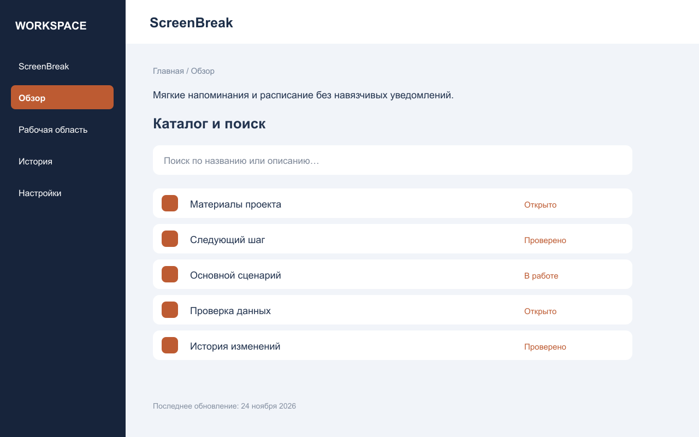
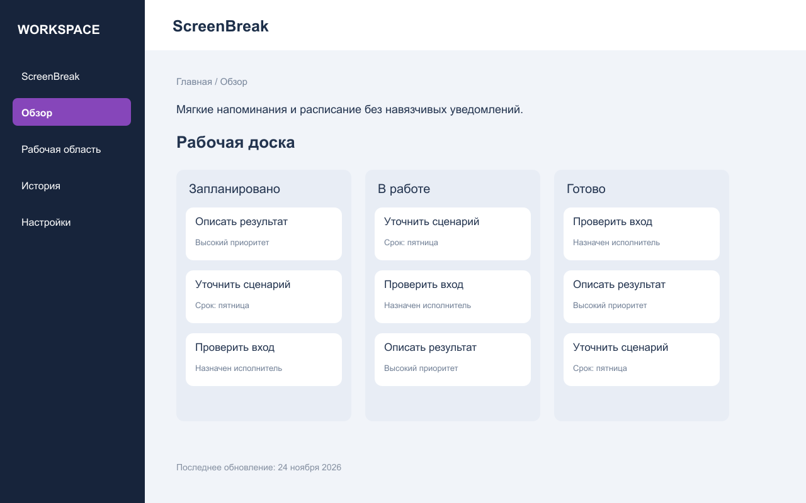

# ScreenBreak

Полина Сергеева Андреевна / Frontend

## Зачем

Короткие перерывы забываются в длинных учебных сессиях.

## Что делает

Мягкие напоминания и расписание без навязчивых уведомлений.

## Личный вклад

локальное хранение, синхронизация и мобильная навигация.

## Что проверено

Пустые данные, повтор действия, сохранение состояния и восстановление после перезапуска.

## Следующий шаг

Измерить время обработки на увеличенном входе.

## Изображения интерфейса

[Портфолио PDF](../documents/portfolios/syn_petproject_008.pdf) / [Презентация PDF](../documents/presentations/syn_petproject_008.pdf)
