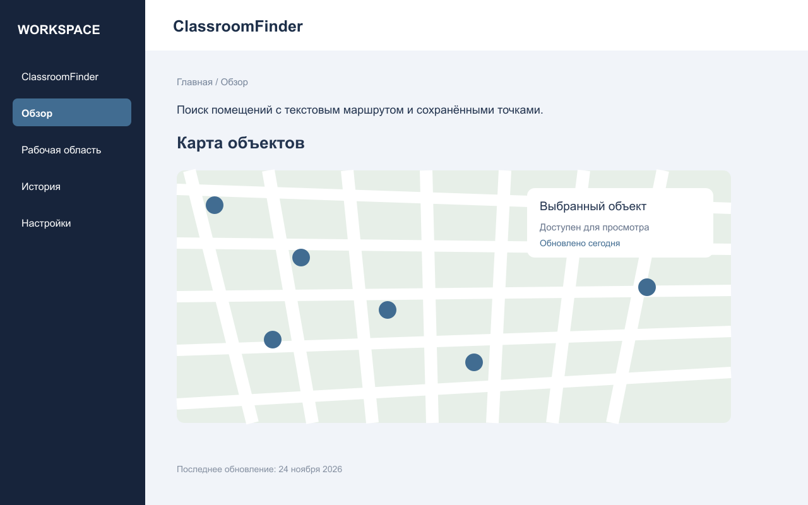
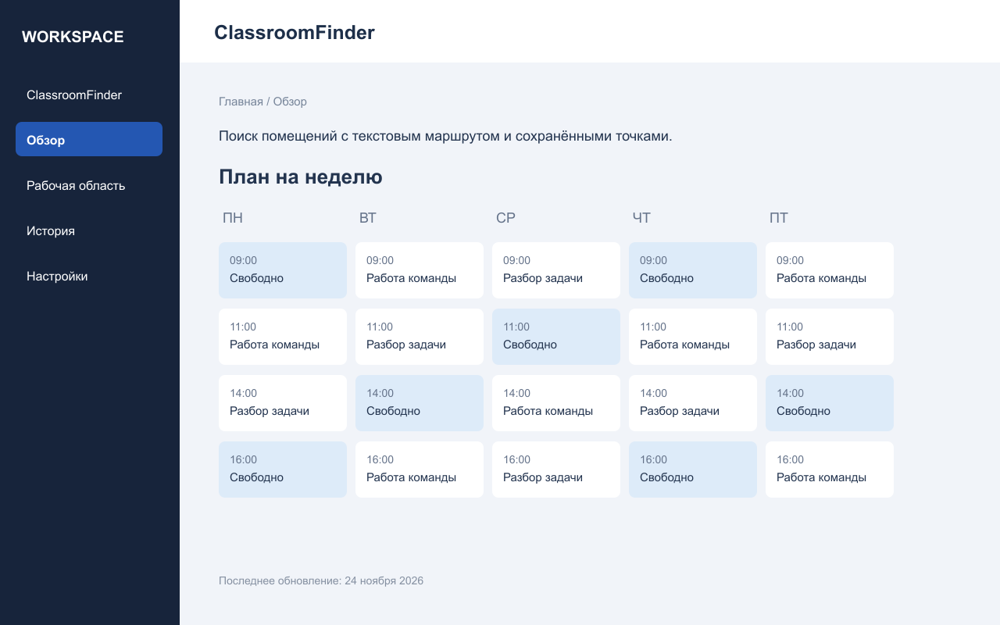

# ClassroomFinder

Даниил Лебедев Алексеевич / Fullstack

## Зачем

В новом корпусе сложно найти аудиторию и ближайший вход.

## Что делает

Поиск помещений с текстовым маршрутом и сохранёнными точками.

## Личный вклад

матрица ответственности, словарь состояний и контракт данных.

## Что проверено

Пустые данные, повтор действия, сохранение состояния и восстановление после перезапуска.

## Следующий шаг

Проверить сценарий на мобильном экране и улучшить навигацию.

## Изображения интерфейса

[Портфолио PDF](../documents/portfolios/syn_petproject_009.pdf) / [Презентация PDF](../documents/presentations/syn_petproject_009.pdf)
