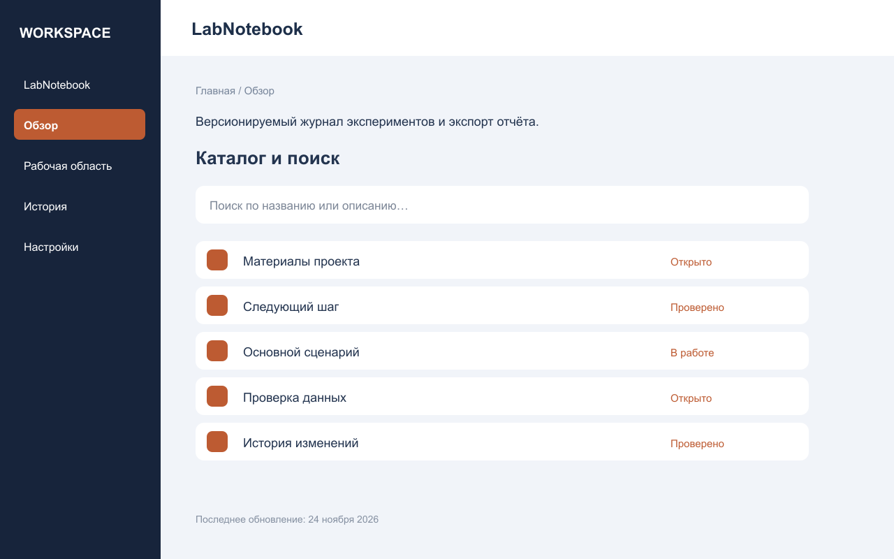
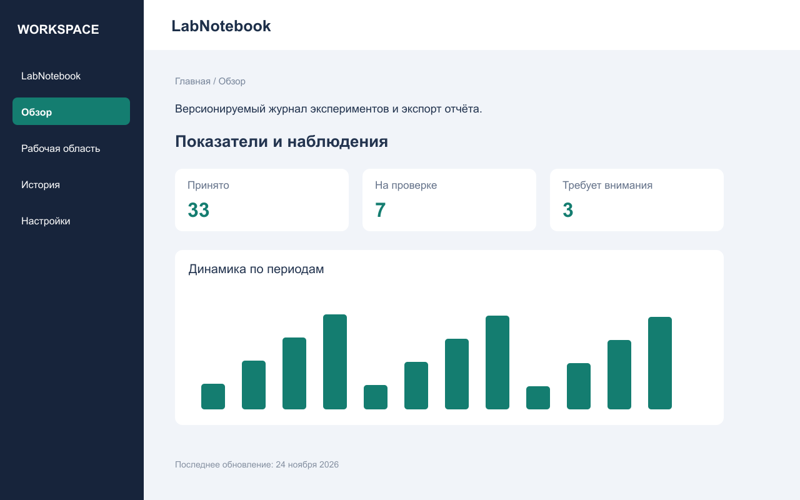

# LabNotebook

София Попова Андреевна / Базы данных

## Зачем

Параметры эксперимента записаны отдельно от результата.

## Что делает

Версионируемый журнал экспериментов и экспорт отчёта.

## Личный вклад

приём сигналов, единицы измерения и журнал предупреждений.

## Что проверено

Пустые данные, повтор действия, сохранение состояния и восстановление после перезапуска.

## Следующий шаг

Добавить импорт и экспорт с понятным отчётом об ошибках.

## Изображения интерфейса

[Портфолио PDF](../documents/portfolios/syn_petproject_010.pdf) / [Презентация PDF](../documents/presentations/syn_petproject_010.pdf)
