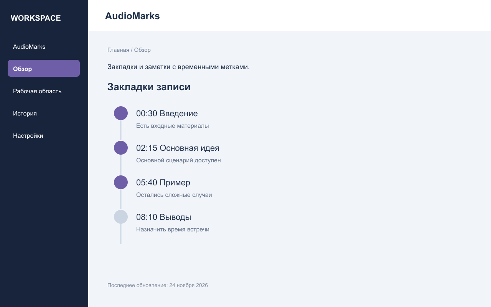
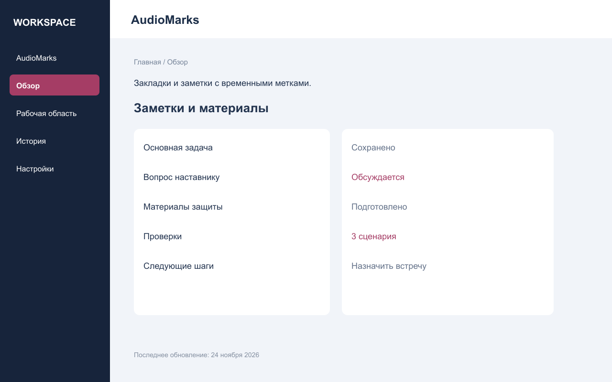

# AudioMarks

Артём Павлов Алексеевич / Мобильная разработка

## Зачем

В длинной лекции сложно повторно найти важный момент.

## Что делает

Закладки и заметки с временными метками.

## Личный вклад

механика, прогресс игрока и обучение без длинных инструкций.

## Что проверено

Пустые данные, повтор действия, сохранение состояния и восстановление после перезапуска.

## Следующий шаг

Собрать наблюдения пользователей и сократить лишние действия.

## Изображения интерфейса

[Портфолио PDF](../documents/portfolios/syn_petproject_011.pdf) / [Презентация PDF](../documents/presentations/syn_petproject_011.pdf)
