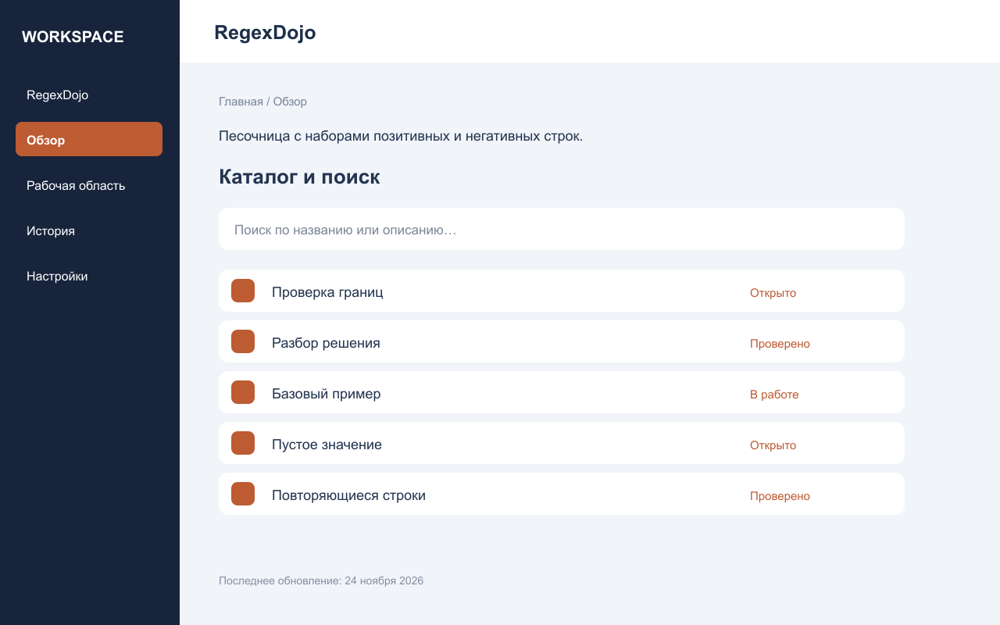
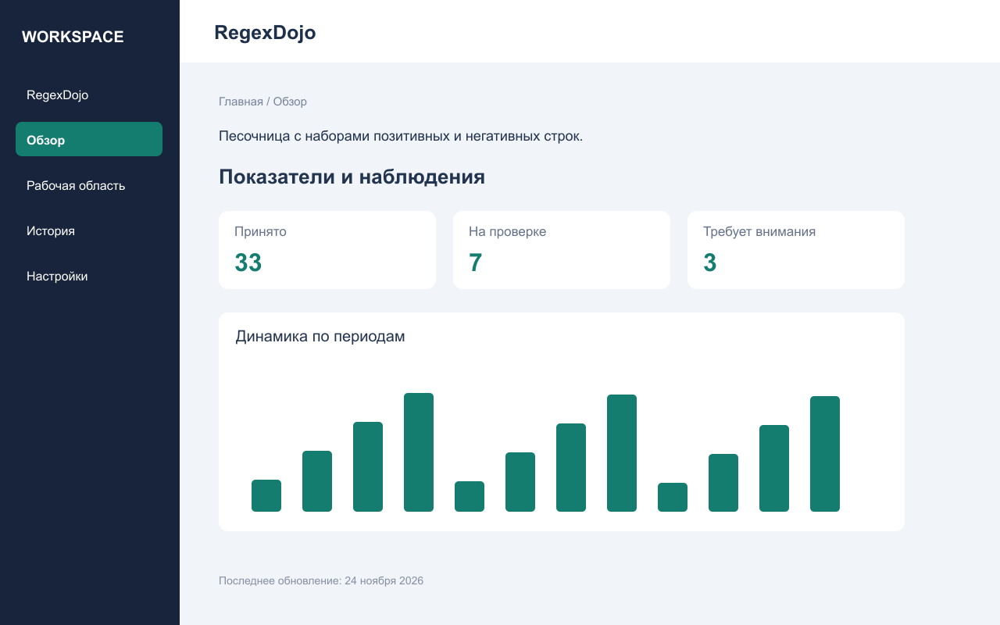

# RegexDojo

Кирилл Семёнов Алексеевич / Программирование

## Зачем

Регулярные выражения проверяются только на удачном примере.

## Что делает

Песочница с наборами позитивных и негативных строк.

## Личный вклад

реализация интерфейса, состояния загрузки и регрессионные проверки.

## Что проверено

Пустые данные, повтор действия, сохранение состояния и восстановление после перезапуска.

## Следующий шаг

Проверить сценарий на мобильном экране и улучшить навигацию.

## Изображения интерфейса

[Портфолио PDF](../documents/portfolios/syn_petproject_013.pdf) / [Презентация PDF](../documents/presentations/syn_petproject_013.pdf)
