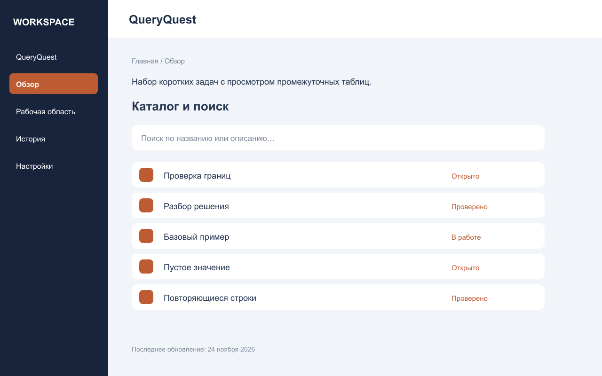
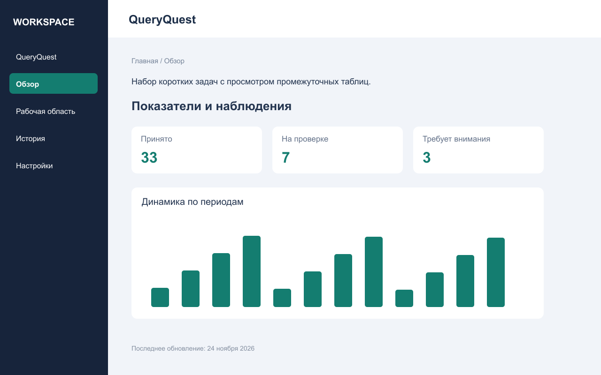

# QueryQuest

Елизавета Зайцева Андреевна / Базы данных

## Зачем

Изучение SQL без объяснения ошибок быстро превращается в угадывание.

## Что делает

Набор коротких задач с просмотром промежуточных таблиц.

## Личный вклад

контракты API, транзакции и обработка конфликтов.

## Что проверено

Пустые данные, повтор действия, сохранение состояния и восстановление после перезапуска.

## Следующий шаг

Добавить импорт и экспорт с понятным отчётом об ошибках.

## Изображения интерфейса

[Портфолио PDF](../documents/portfolios/syn_petproject_014.pdf) / [Презентация PDF](../documents/presentations/syn_petproject_014.pdf)
