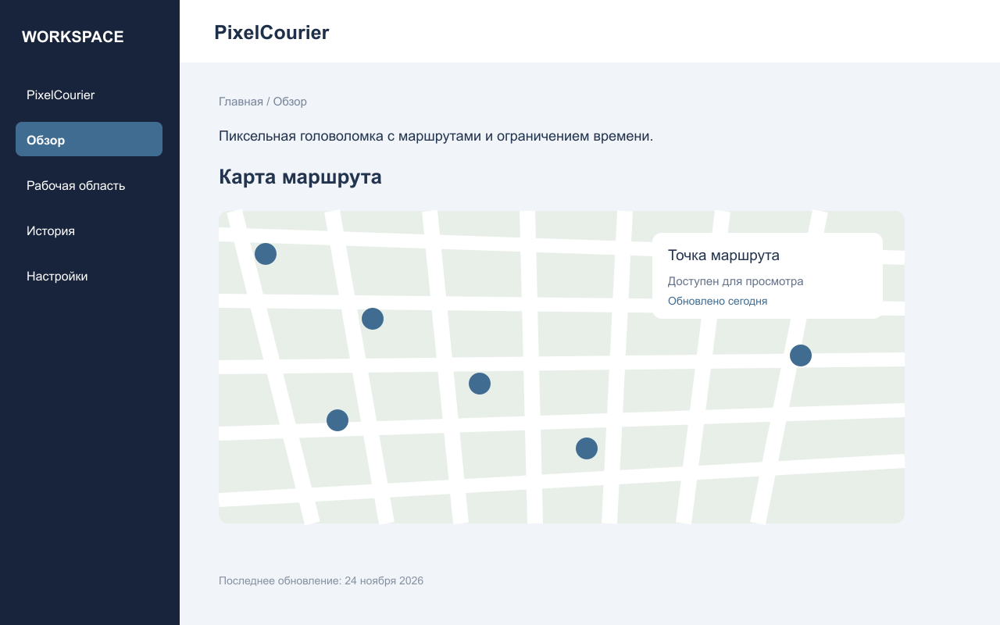
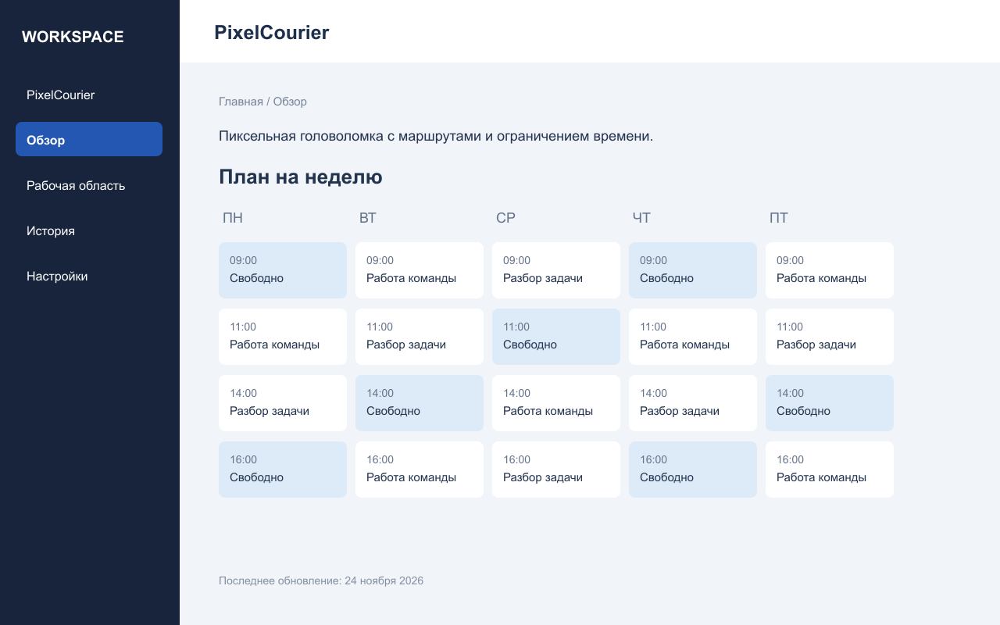

# PixelCourier

Андрей Громов Алексеевич / Разработка игр

## Зачем

В маленькой игре хочется исследовать разные стратегии доставки.

## Что делает

Пиксельная головоломка с маршрутами и ограничением времени.

## Личный вклад

профилирование входа, контрольные расчёты и визуализация.

## Что проверено

Пустые данные, повтор действия, сохранение состояния и восстановление после перезапуска.

## Следующий шаг

Собрать наблюдения пользователей и сократить лишние действия.

## Изображения интерфейса

[Портфолио PDF](../documents/portfolios/syn_petproject_015.pdf) / [Презентация PDF](../documents/presentations/syn_petproject_015.pdf)
