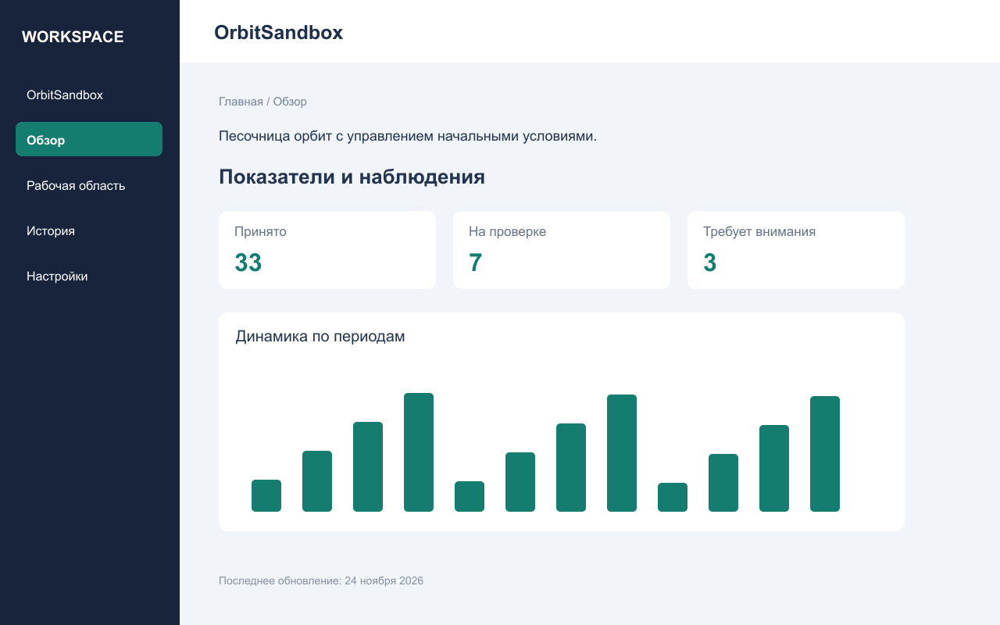
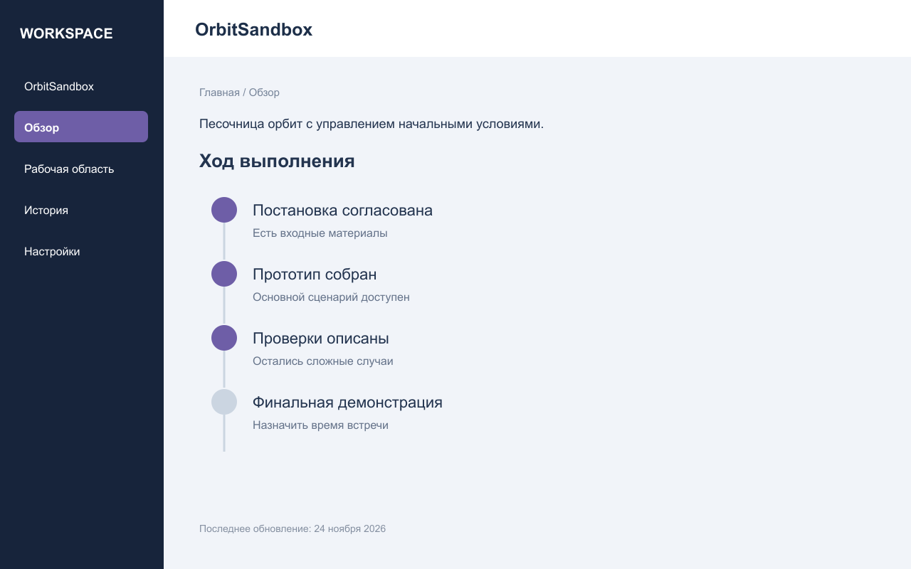

# OrbitSandbox

Ксения Фролова Андреевна / Физика

## Зачем

Параметры движения трудно связать с траекторией по формулам.

## Что делает

Песочница орбит с управлением начальными условиями.

## Личный вклад

карта пути пользователя, прототипы и библиотека состояний.

## Что проверено

Пустые данные, повтор действия, сохранение состояния и восстановление после перезапуска.

## Следующий шаг

Измерить время обработки на увеличенном входе.

## Изображения интерфейса

[Портфолио PDF](../documents/portfolios/syn_petproject_016.pdf) / [Презентация PDF](../documents/presentations/syn_petproject_016.pdf)
