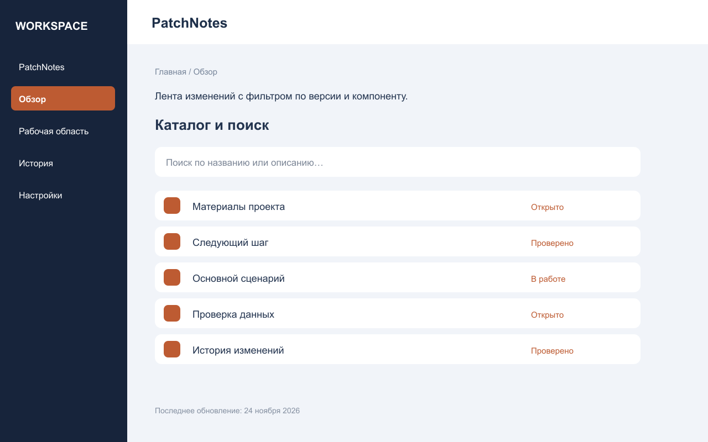
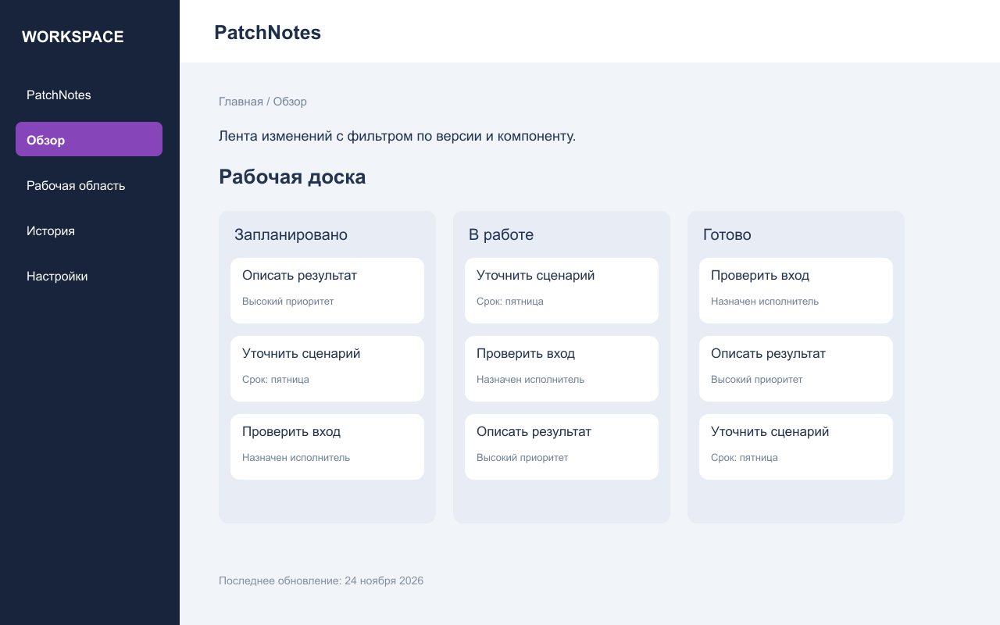

# PatchNotes

Алексей Миронов Сергеевич / Fullstack

## Зачем

Заметки о релизе не связаны с задачами и исправлениями.

## Что делает

Лента изменений с фильтром по версии и компоненту.

## Личный вклад

тест-дизайн, автоматизация и отчёты о дефектах.

## Что проверено

Пустые данные, повтор действия, сохранение состояния и восстановление после перезапуска.

## Следующий шаг

Проверить сценарий на мобильном экране и улучшить навигацию.

## Изображения интерфейса

[Портфолио PDF](../documents/portfolios/syn_petproject_017.pdf) / [Презентация PDF](../documents/presentations/syn_petproject_017.pdf)
