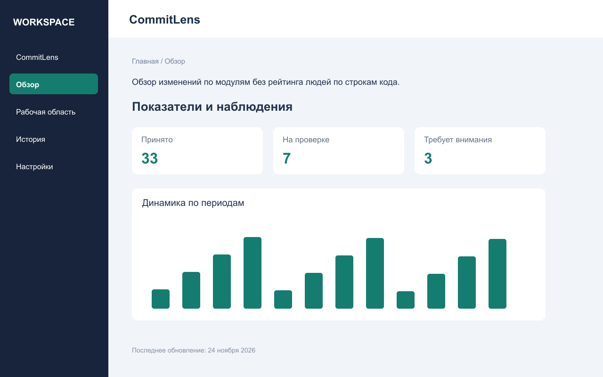
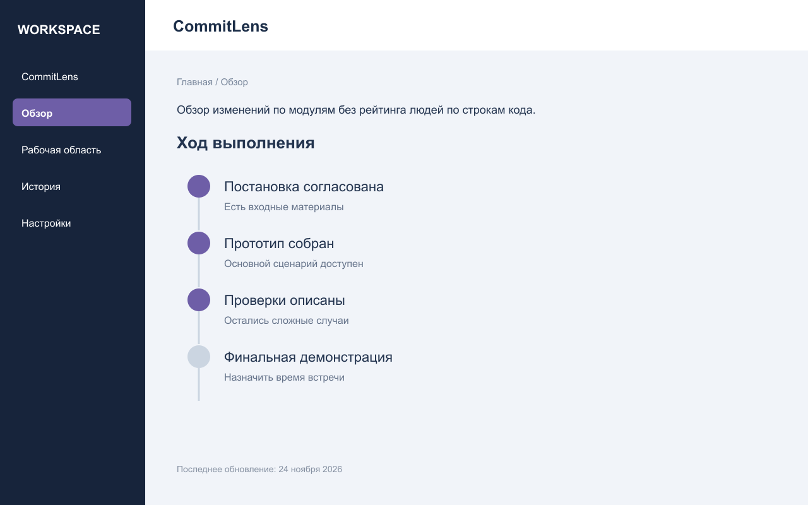

# CommitLens

Мария Белова Викторовна / Data Science

## Зачем

Команда видит количество коммитов, но не структуру работы.

## Что делает

Обзор изменений по модулям без рейтинга людей по строкам кода.

## Личный вклад

подготовка выборки, оценка ошибок и сервис предсказаний.

## Что проверено

Пустые данные, повтор действия, сохранение состояния и восстановление после перезапуска.

## Следующий шаг

Добавить импорт и экспорт с понятным отчётом об ошибках.

## Изображения интерфейса

[Портфолио PDF](../documents/portfolios/syn_petproject_018.pdf) / [Презентация PDF](../documents/presentations/syn_petproject_018.pdf)
