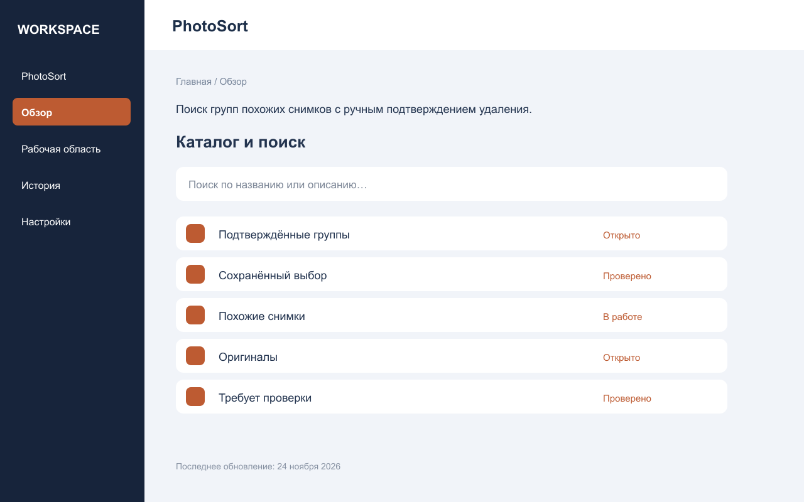
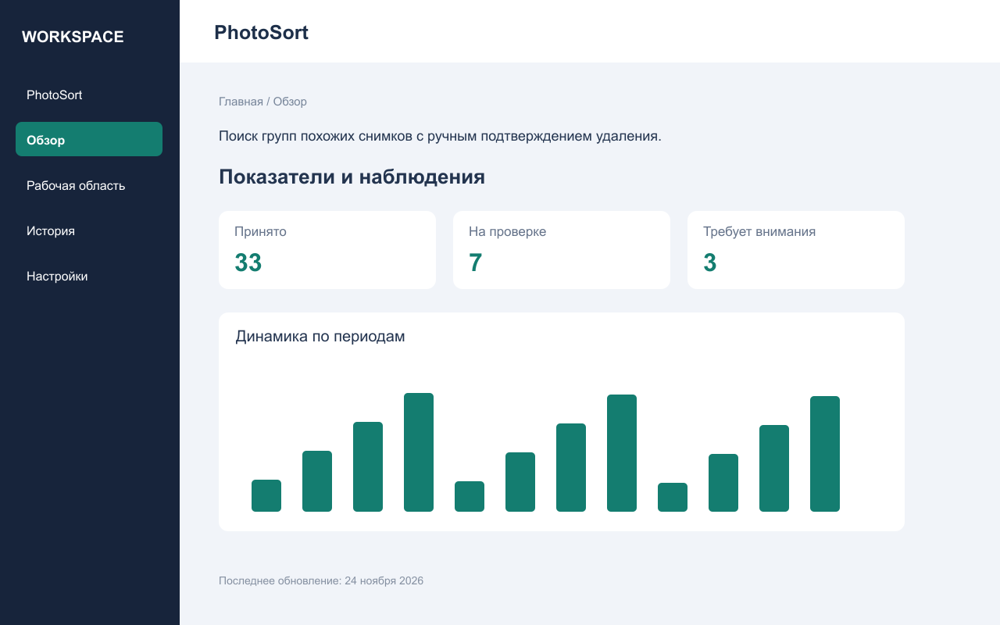

# PhotoSort

Тимур Сафин Сергеевич / Компьютерное зрение

## Зачем

На диске много похожих фотографий с разными именами.

## Что делает

Поиск групп похожих снимков с ручным подтверждением удаления.

## Личный вклад

окружение, журналы, панели и инструкция восстановления.

## Что проверено

Пустые данные, повтор действия, сохранение состояния и восстановление после перезапуска.

## Следующий шаг

Собрать наблюдения пользователей и сократить лишние действия.

## Изображения интерфейса

[Портфолио PDF](../documents/portfolios/syn_petproject_019.pdf) / [Презентация PDF](../documents/presentations/syn_petproject_019.pdf)
