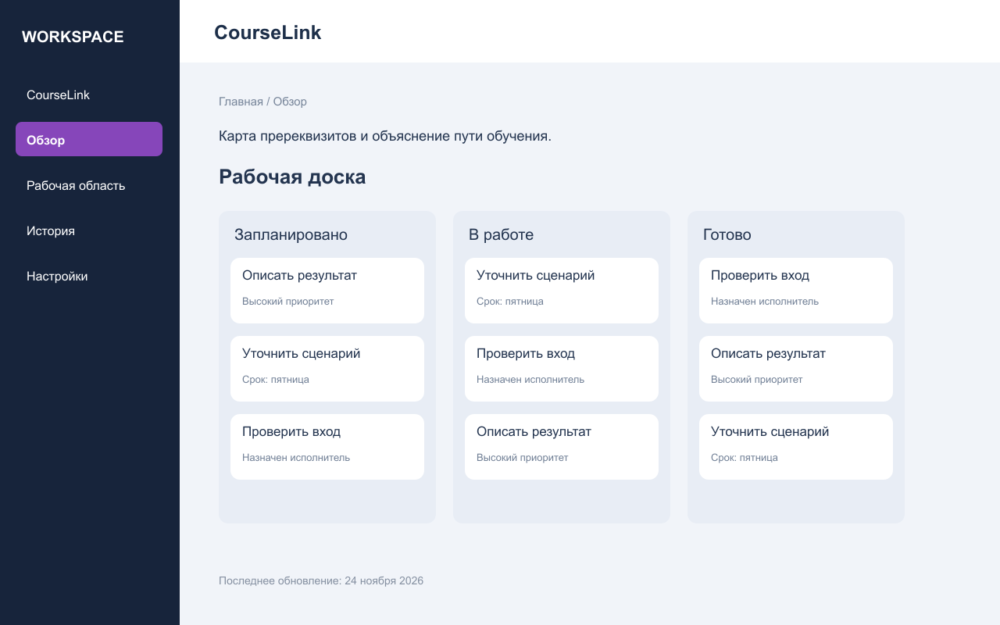
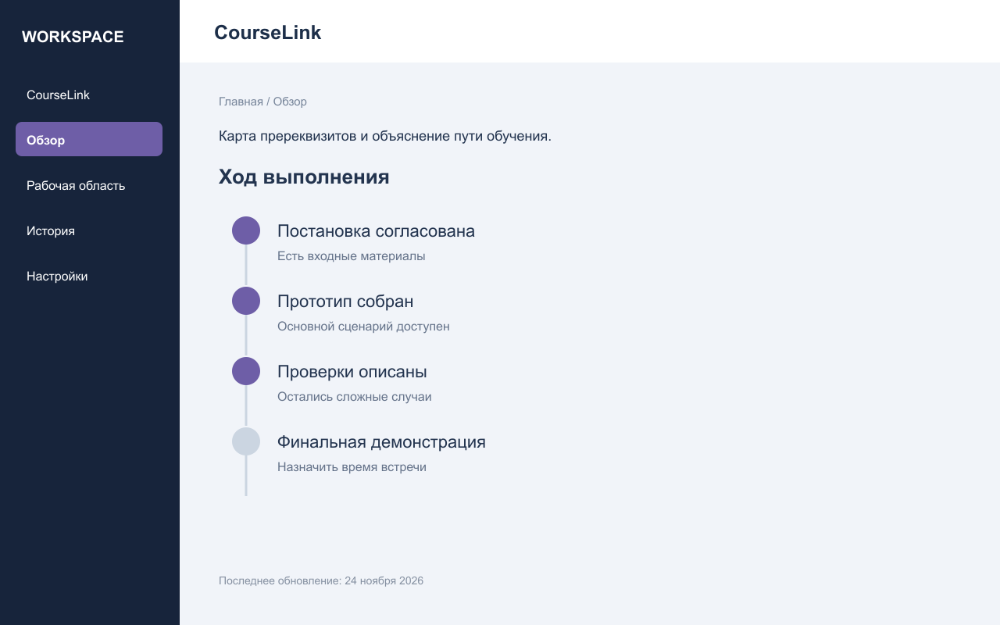

# CourseLink

Анна Волкова Викторовна / Системный анализ

## Зачем

Неясно, какие знания нужны до выбранного курса.

## Что делает

Карта пререквизитов и объяснение пути обучения.

## Личный вклад

локальное хранение, синхронизация и мобильная навигация.

## Что проверено

Пустые данные, повтор действия, сохранение состояния и восстановление после перезапуска.

## Следующий шаг

Измерить время обработки на увеличенном входе.

## Изображения интерфейса

[Портфолио PDF](../documents/portfolios/syn_petproject_020.pdf) / [Презентация PDF](../documents/presentations/syn_petproject_020.pdf)
