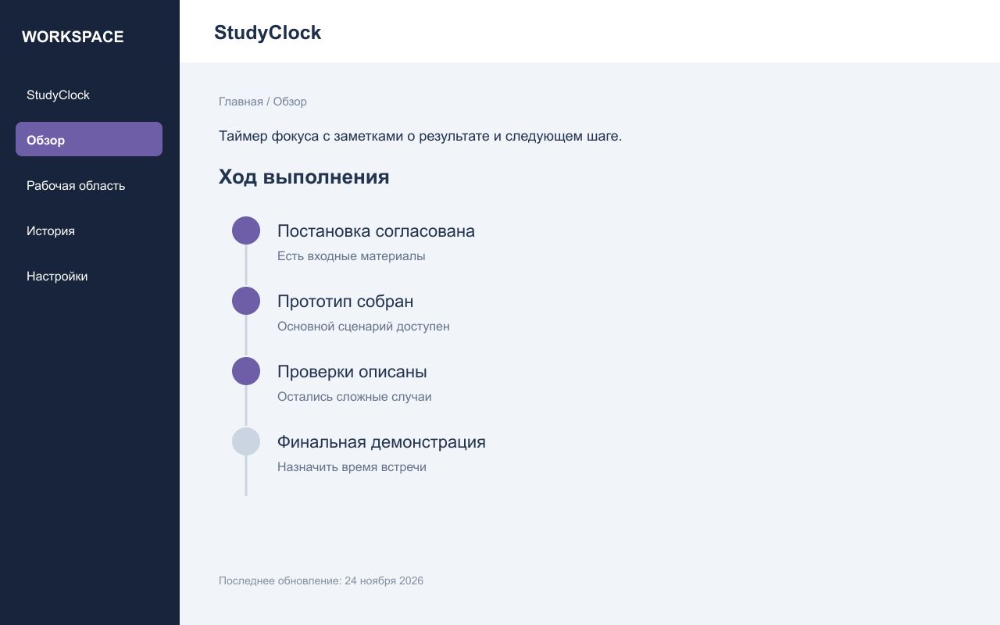
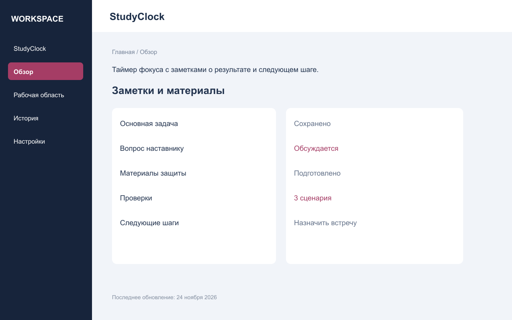

# StudyClock

Максим Орлов Сергеевич / Мобильная разработка

## Зачем

Учебные сессии не учитывают время на разбор ошибок.

## Что делает

Таймер фокуса с заметками о результате и следующем шаге.

## Личный вклад

матрица ответственности, словарь состояний и контракт данных.

## Что проверено

Пустые данные, повтор действия, сохранение состояния и восстановление после перезапуска.

## Следующий шаг

Проверить сценарий на мобильном экране и улучшить навигацию.

## Изображения интерфейса

[Портфолио PDF](../documents/portfolios/syn_petproject_021.pdf) / [Презентация PDF](../documents/presentations/syn_petproject_021.pdf)
