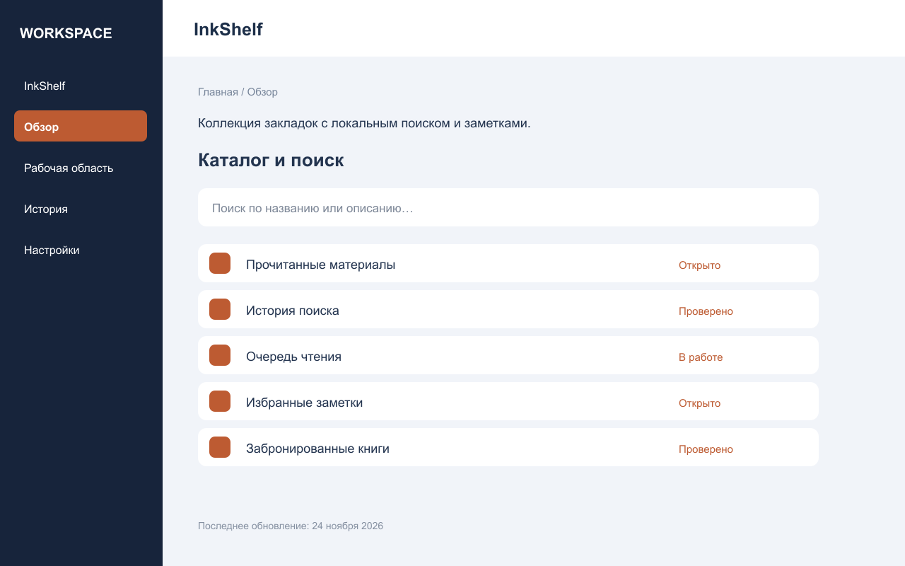
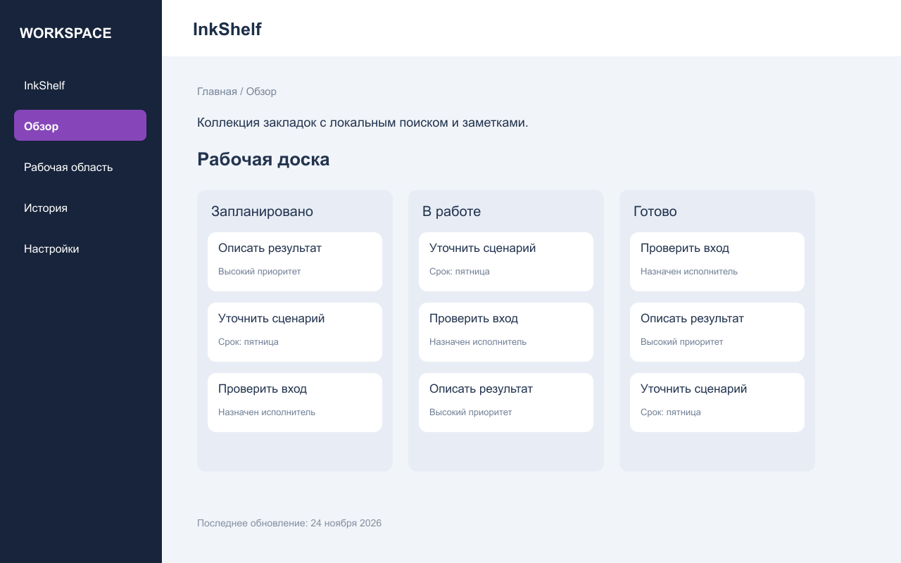

# InkShelf

Дарья Соколова Викторовна / Frontend

## Зачем

Полезные статьи сохраняются, но потом их не найти.

## Что делает

Коллекция закладок с локальным поиском и заметками.

## Личный вклад

приём сигналов, единицы измерения и журнал предупреждений.

## Что проверено

Пустые данные, повтор действия, сохранение состояния и восстановление после перезапуска.

## Следующий шаг

Добавить импорт и экспорт с понятным отчётом об ошибках.

## Изображения интерфейса

[Портфолио PDF](../documents/portfolios/syn_petproject_022.pdf) / [Презентация PDF](../documents/presentations/syn_petproject_022.pdf)
