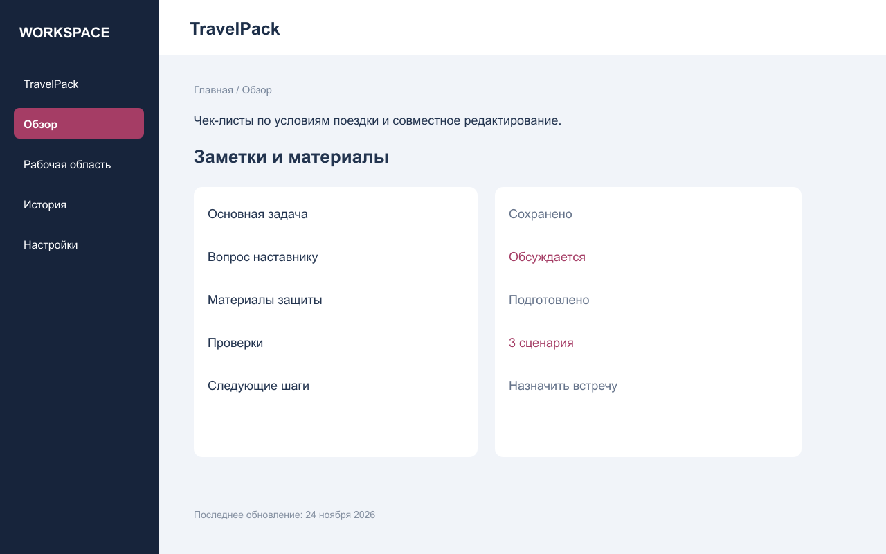
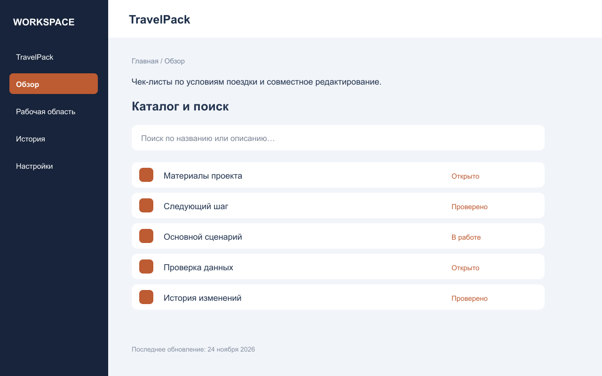

# TravelPack

Руслан Хакимов Сергеевич / UX/UI

## Зачем

Перед короткой поездкой каждый раз составляется один и тот же список.

## Что делает

Чек-листы по условиям поездки и совместное редактирование.

## Личный вклад

механика, прогресс игрока и обучение без длинных инструкций.

## Что проверено

Пустые данные, повтор действия, сохранение состояния и восстановление после перезапуска.

## Следующий шаг

Собрать наблюдения пользователей и сократить лишние действия.

## Изображения интерфейса

[Портфолио PDF](../documents/portfolios/syn_petproject_023.pdf) / [Презентация PDF](../documents/presentations/syn_petproject_023.pdf)
