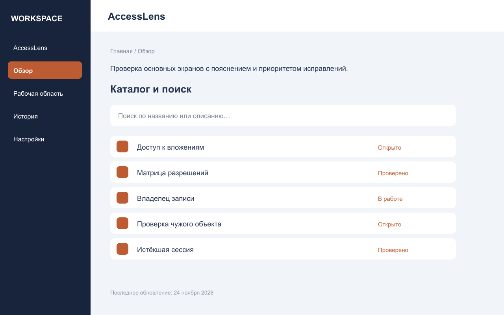
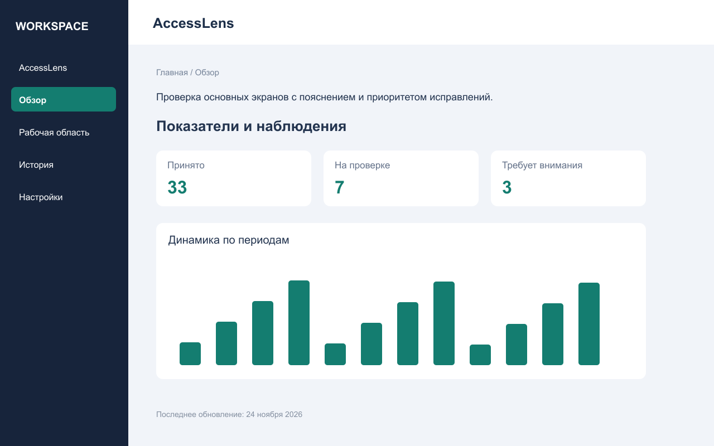

# AccessLens

Екатерина Морозова Викторовна / Тестирование

## Зачем

Проблемы доступности обнаруживаются перед самой демонстрацией.

## Что делает

Проверка основных экранов с пояснением и приоритетом исправлений.

## Личный вклад

обработка изображений, разметка и сравнение результатов.

## Что проверено

Пустые данные, повтор действия, сохранение состояния и восстановление после перезапуска.

## Следующий шаг

Измерить время обработки на увеличенном входе.

## Изображения интерфейса

[Портфолио PDF](../documents/portfolios/syn_petproject_024.pdf) / [Презентация PDF](../documents/presentations/syn_petproject_024.pdf)
