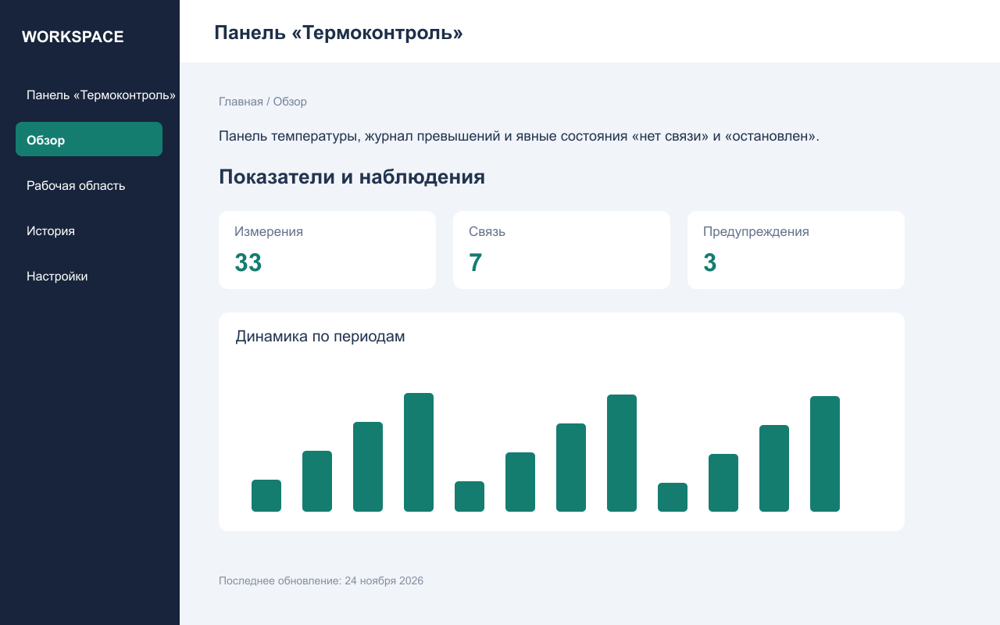
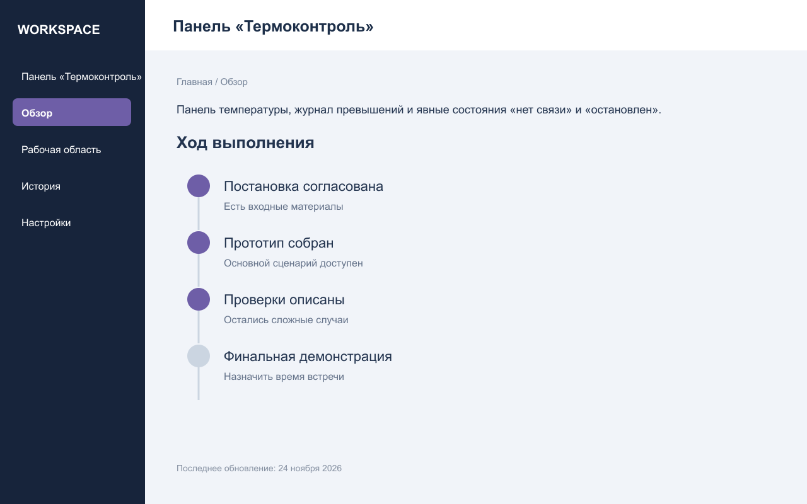

# Панель «Термоконтроль»

Алексей Миронов / IoT

## Задача

Показания 12 насосов приходят с задержкой; инженер путает остановку оборудования и потерю связи.

## Решение

Панель температуры, журнал превышений и явные состояния «нет связи» и «остановлен».

## Основной сценарий

Повтор сообщения не создаёт второе событие; пропуск показания не превращается в ноль.

## Личный вклад

Модель данных и API, обработка ошибок и инструкция развёртывания.

## Следующий этап

Расширить контрольные сценарии и проверить поведение на неполном входе.

## Изображения интерфейса

[Портфолио PDF](../documents/portfolios/syn_project_001.pdf) / [Презентация PDF](../documents/presentations/syn_project_001.pdf) / [Видео](../documents/videos/syn_project_001-demo.mp4)
