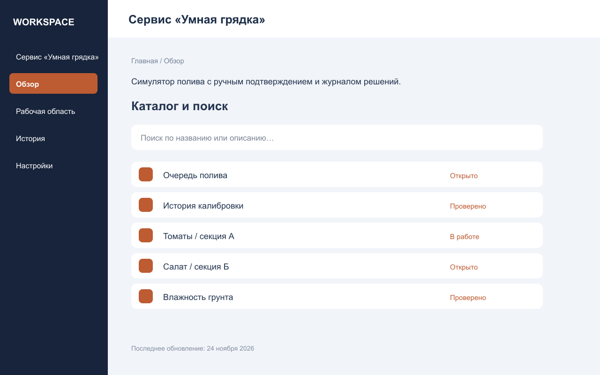
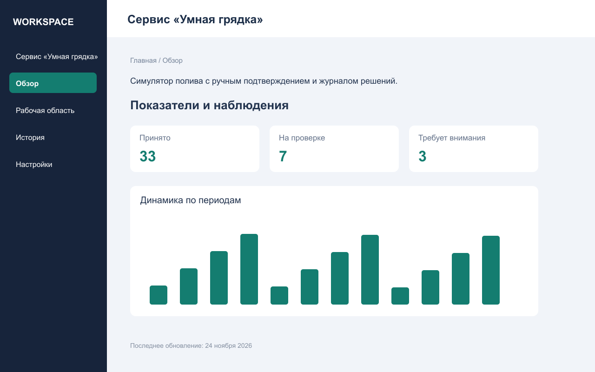

# Сервис «Умная грядка»

Мария Белова / Автоматизация

## Задача

Расписание полива ведётся отдельно от показаний влажности.

## Решение

Симулятор полива с ручным подтверждением и журналом решений.

## Основной сценарий

Устаревший датчик блокирует автоматический запуск; реальное оборудование не подключается.

## Личный вклад

Пользовательские сценарии, макеты и интерфейс с состояниями загрузки.

## Следующий этап

Добавить обратную связь пользователей и уточнить основной сценарий.

## Изображения интерфейса

[Портфолио PDF](../documents/portfolios/syn_project_002.pdf) / [Презентация PDF](../documents/presentations/syn_project_002.pdf) / [Видео](../documents/videos/syn_project_002-demo.webm)
