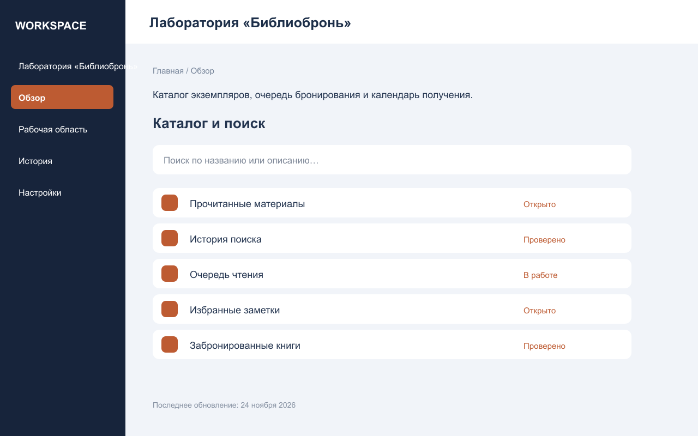
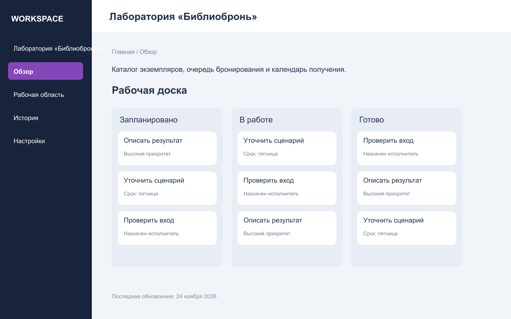

# Лаборатория «Библиобронь»

Тимур Сафин / Fullstack

## Задача

Читатель узнаёт о недоступности экземпляра после поездки в библиотеку.

## Решение

Каталог экземпляров, очередь бронирования и календарь получения.

## Основной сценарий

Два читателя не получают один экземпляр одновременно; отмена освобождает очередь.

## Личный вклад

Исследование входных данных, сравнение подходов и графики результатов.

## Следующий этап

Оптимизировать обработку больших наборов и измерить потребление памяти.

## Изображения интерфейса

[Портфолио PDF](../documents/portfolios/syn_project_003.pdf) / [Презентация PDF](../documents/presentations/syn_project_003.pdf)
