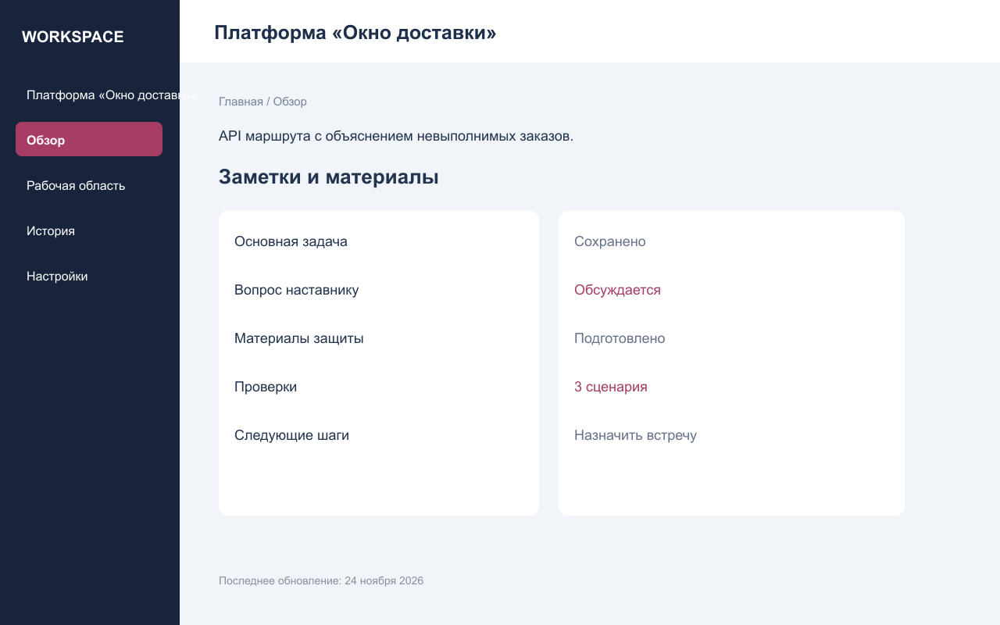
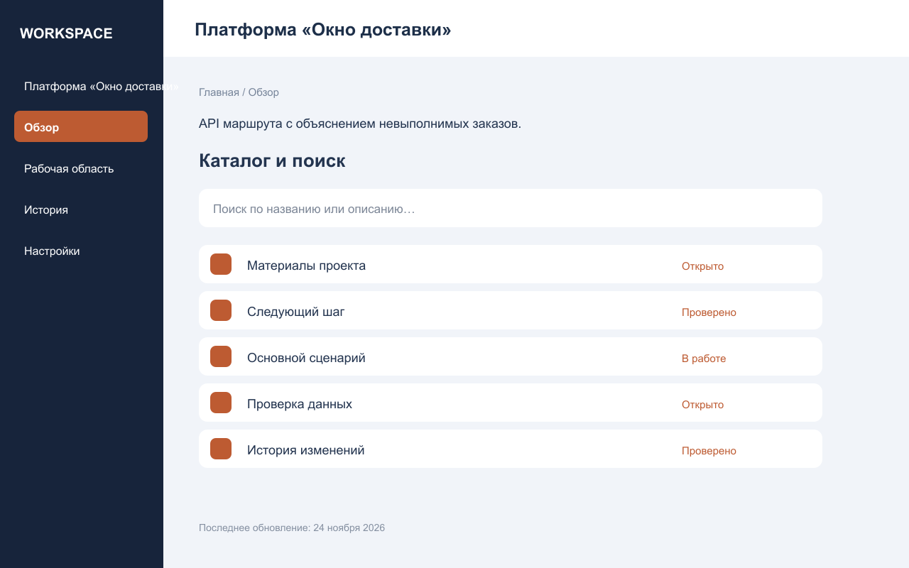

# Платформа «Окно доставки»

Анна Волкова / Backend

## Задача

Курьер получает адреса без учёта времени доставки и вместимости.

## Решение

API маршрута с объяснением невыполнимых заказов.

## Основной сценарий

Невозможное окно выделено; груз не превышает вместимость; сравнение с исходным маршрутом воспроизводимо.

## Личный вклад

Матрица проверок, регрессионные сценарии и разбор ограничений.

## Следующий этап

Подготовить демонстрацию и документацию для передачи следующей команде.

## Изображения интерфейса

[Портфолио PDF](../documents/portfolios/syn_project_004.pdf) / [Презентация PDF](../documents/presentations/syn_project_004.pdf)
