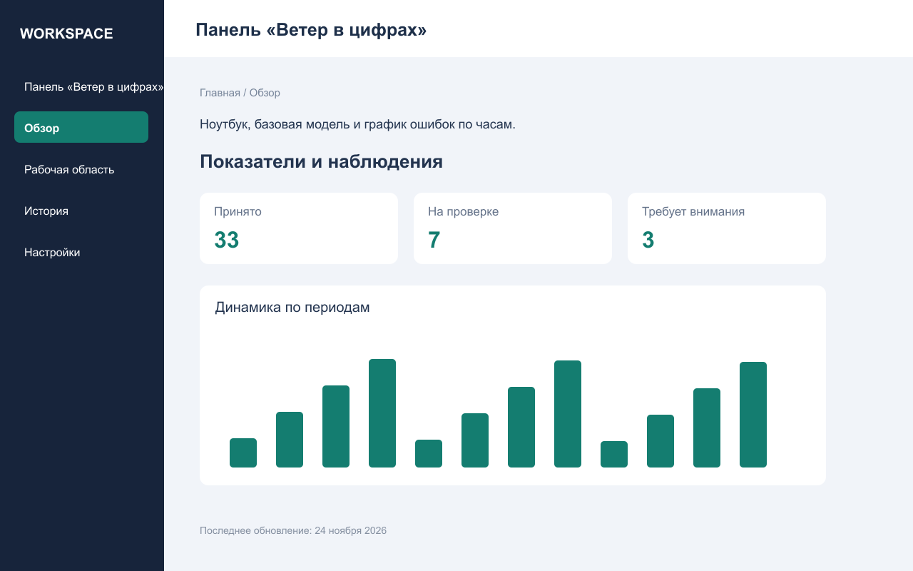
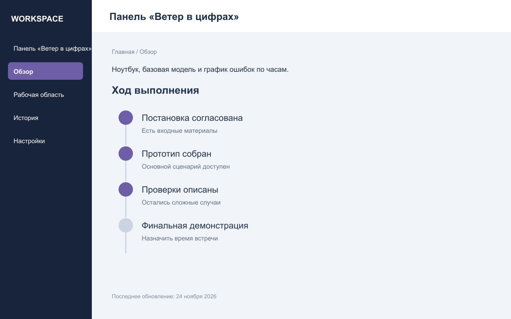

# Панель «Ветер в цифрах»

Максим Орлов / Data Science

## Задача

Диспетчеру нужен прогноз на сутки с объяснением неопределённости.

## Решение

Ноутбук, базовая модель и график ошибок по часам.

## Основной сценарий

Обучение отделено по времени; есть сравнение с прогнозом «как вчера».

## Личный вклад

Модель данных и API, обработка ошибок и инструкция развёртывания.

## Следующий этап

Расширить контрольные сценарии и проверить поведение на неполном входе.

## Изображения интерфейса

[Портфолио PDF](../documents/portfolios/syn_project_005.pdf) / [Презентация PDF](../documents/presentations/syn_project_005.pdf)
