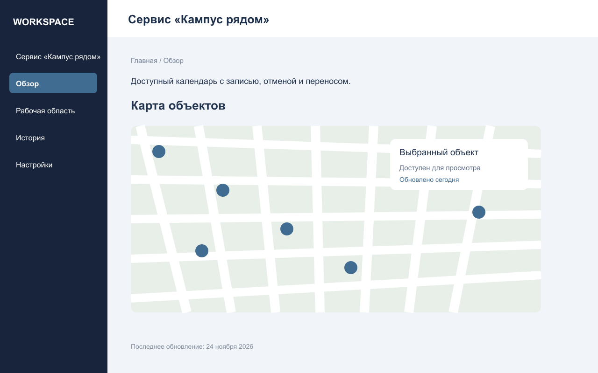
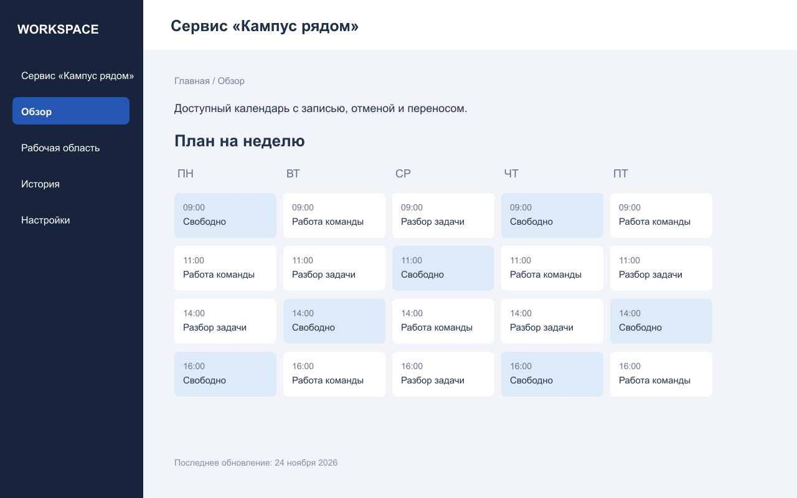

# Сервис «Кампус рядом»

Дарья Соколова / Frontend

## Задача

Запись к преподавателям в переписке приводит к конфликтам и пропущенным переносам.

## Решение

Доступный календарь с записью, отменой и переносом.

## Основной сценарий

Сценарий работает с клавиатуры; конфликт записи предлагает свободное время.

## Личный вклад

Пользовательские сценарии, макеты и интерфейс с состояниями загрузки.

## Следующий этап

Добавить обратную связь пользователей и уточнить основной сценарий.

## Изображения интерфейса

[Портфолио PDF](../documents/portfolios/syn_project_006.pdf) / [Презентация PDF](../documents/presentations/syn_project_006.pdf)
