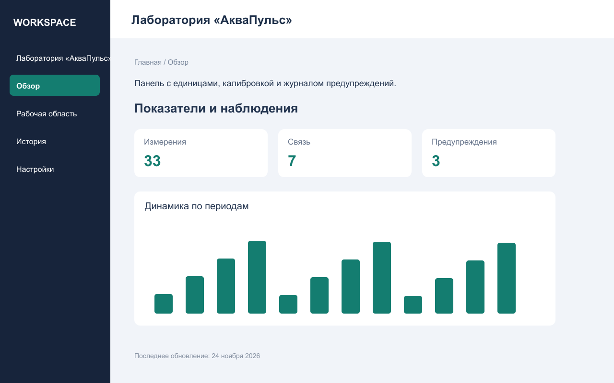
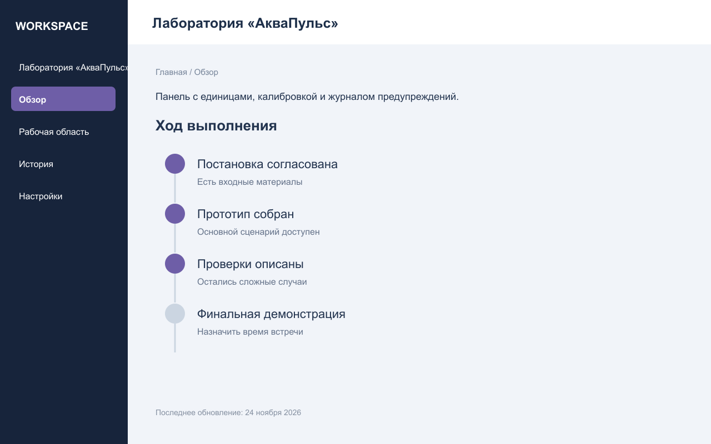

# Лаборатория «АкваПульс»

Руслан Хакимов / IoT

## Задача

Измерения pH и температуры поступают с пропусками и разными единицами.

## Решение

Панель с единицами, калибровкой и журналом предупреждений.

## Основной сценарий

Невалидное показание не усредняется; результат не называется санитарным заключением.

## Личный вклад

Исследование входных данных, сравнение подходов и графики результатов.

## Следующий этап

Оптимизировать обработку больших наборов и измерить потребление памяти.

## Изображения интерфейса

[Портфолио PDF](../documents/portfolios/syn_project_007.pdf) / [Презентация PDF](../documents/presentations/syn_project_007.pdf)
