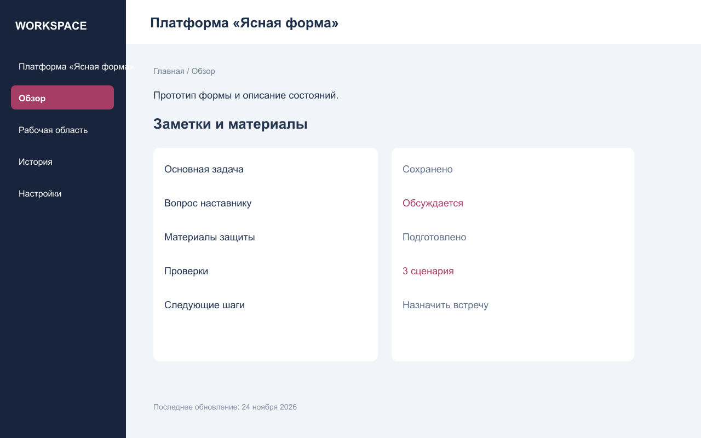
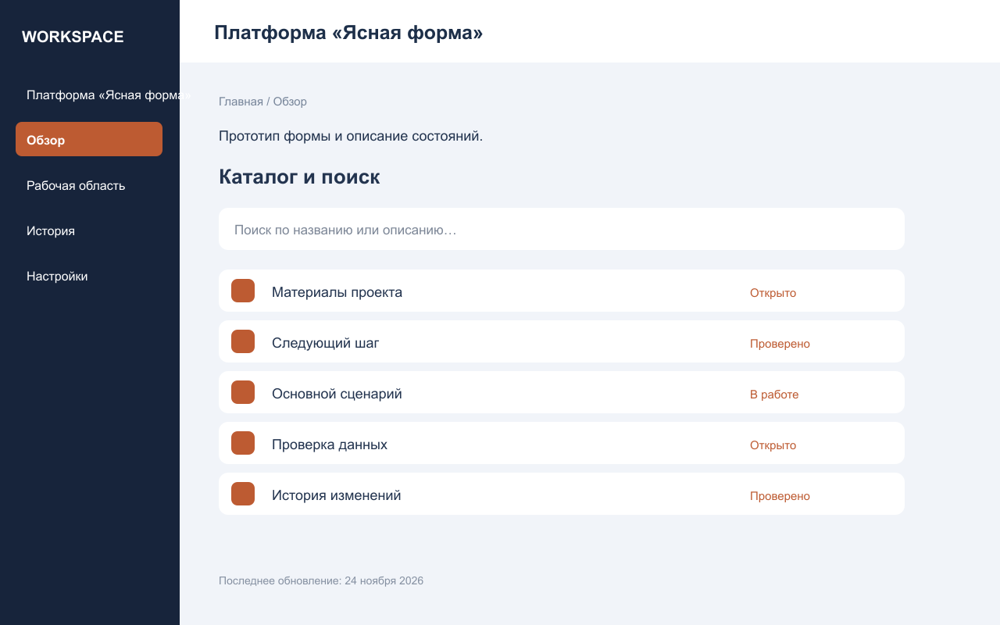

# Платформа «Ясная форма»

Екатерина Морозова / UX/UI

## Задача

Скринридер не связывает поля с сообщениями об ошибке.

## Решение

Прототип формы и описание состояний.

## Основной сценарий

Ошибки связаны с полями; фокус предсказуем; цвет не единственный сигнал.

## Личный вклад

Матрица проверок, регрессионные сценарии и разбор ограничений.

## Следующий этап

Подготовить демонстрацию и документацию для передачи следующей команде.

## Изображения интерфейса

[Портфолио PDF](../documents/portfolios/syn_project_008.pdf) / [Презентация PDF](../documents/presentations/syn_project_008.pdf)
