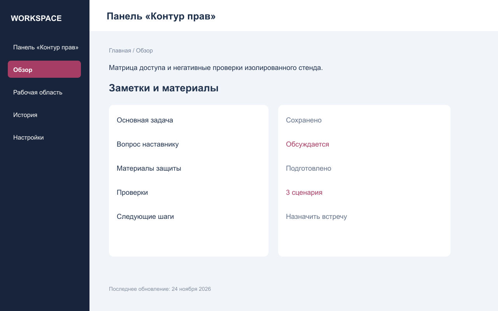
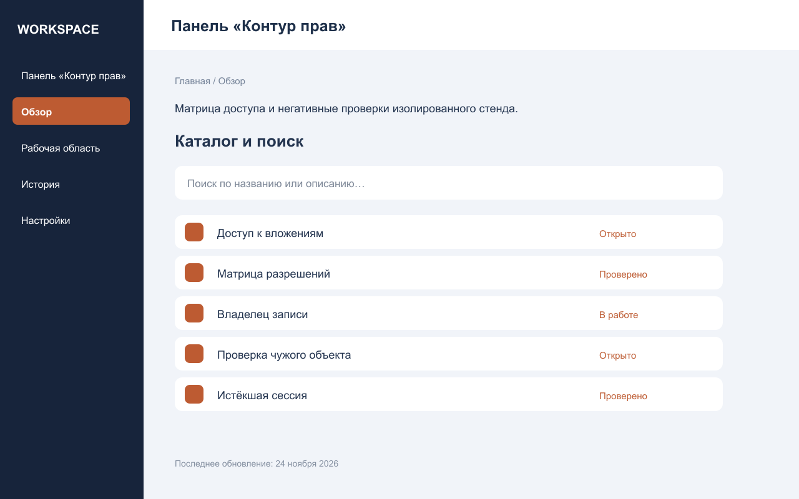

# Панель «Контур прав»

Никита Фёдоров / Информационная безопасность

## Задача

Права владельца записи и модератора проверяются в разных местах.

## Решение

Матрица доступа и негативные проверки изолированного стенда.

## Основной сценарий

Проверен запрос чужого объекта; внешние системы не сканируются.

## Личный вклад

Модель данных и API, обработка ошибок и инструкция развёртывания.

## Следующий этап

Расширить контрольные сценарии и проверить поведение на неполном входе.

## Изображения интерфейса

[Портфолио PDF](../documents/portfolios/syn_project_009.pdf) / [Презентация PDF](../documents/presentations/syn_project_009.pdf)
