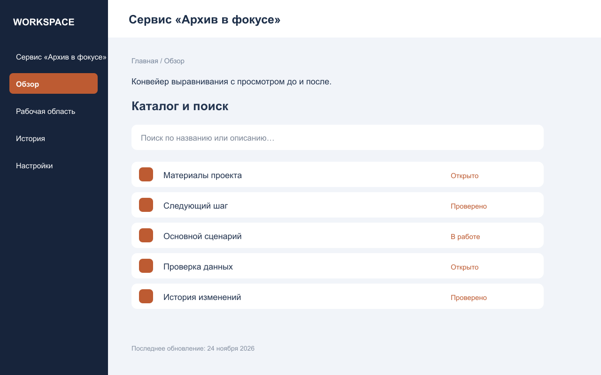
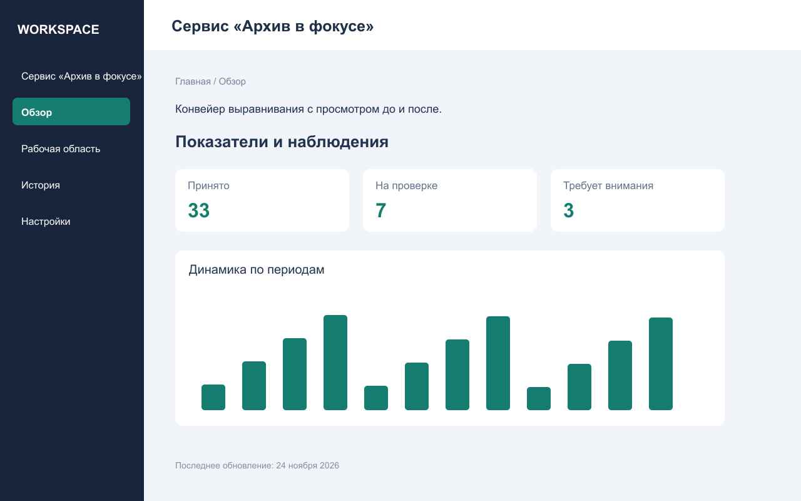

# Сервис «Архив в фокусе»

Алина Иванова / Компьютерное зрение

## Задача

Страницы сняты под углом, распознавание теряет строки.

## Решение

Конвейер выравнивания с просмотром до и после.

## Основной сценарий

Заметки на полях не обрезаны; сложные кадры отправляются на ручную проверку.

## Личный вклад

Пользовательские сценарии, макеты и интерфейс с состояниями загрузки.

## Следующий этап

Добавить обратную связь пользователей и уточнить основной сценарий.

## Изображения интерфейса

[Портфолио PDF](../documents/portfolios/syn_project_010.pdf) / [Презентация PDF](../documents/presentations/syn_project_010.pdf)
