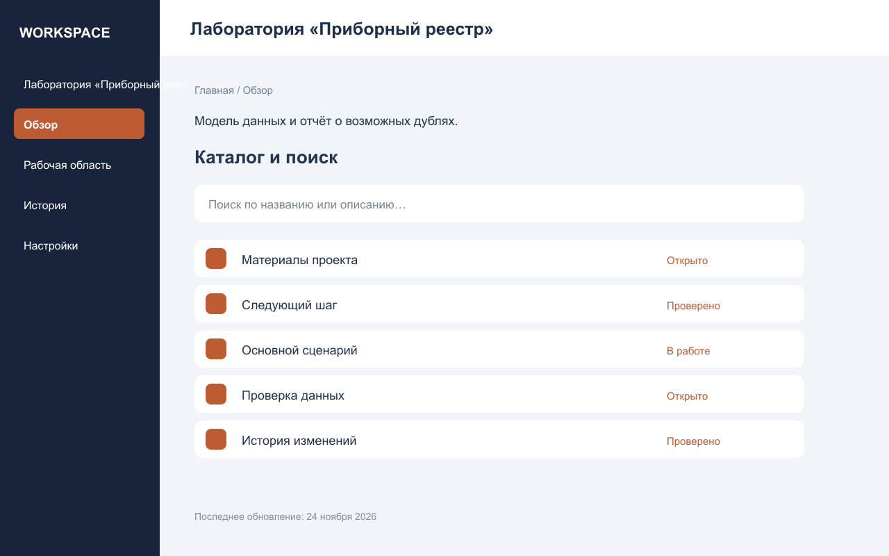
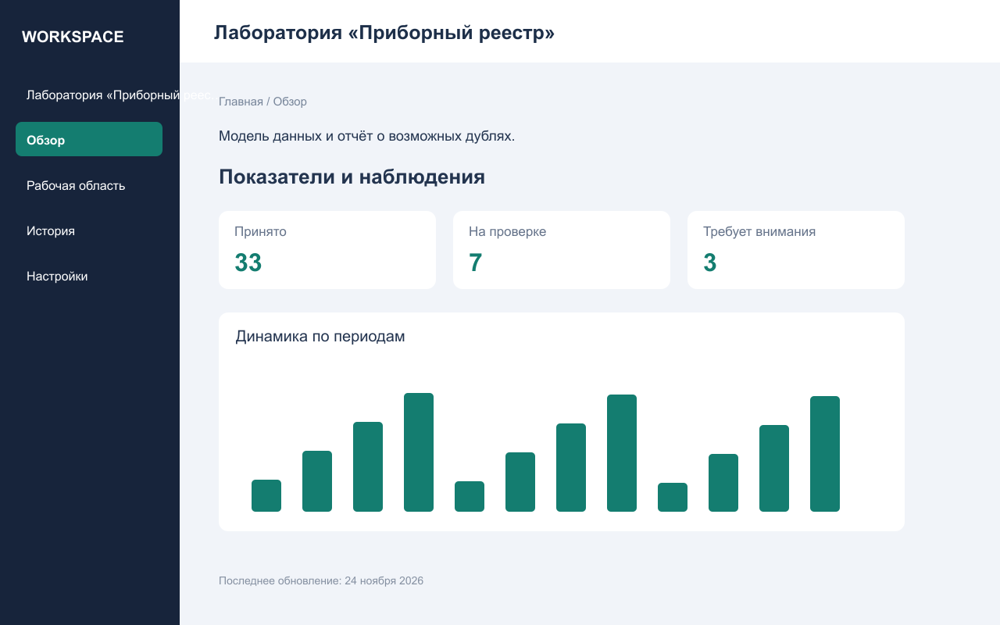

# Лаборатория «Приборный реестр»

Илья Новиков / Базы данных

## Задача

Одно устройство записано под разными инвентарными обозначениями.

## Решение

Модель данных и отчёт о возможных дублях.

## Основной сценарий

Слияние сохраняет обслуживание; номер уникален в подразделении.

## Личный вклад

Исследование входных данных, сравнение подходов и графики результатов.

## Следующий этап

Оптимизировать обработку больших наборов и измерить потребление памяти.

## Изображения интерфейса

[Портфолио PDF](../documents/portfolios/syn_project_011.pdf) / [Презентация PDF](../documents/presentations/syn_project_011.pdf)
