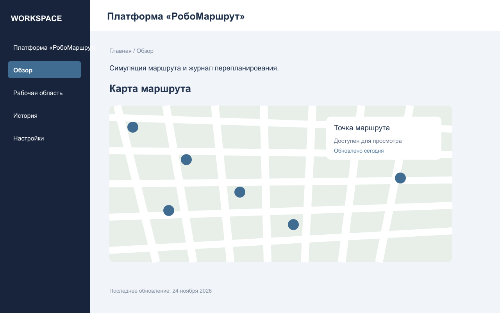
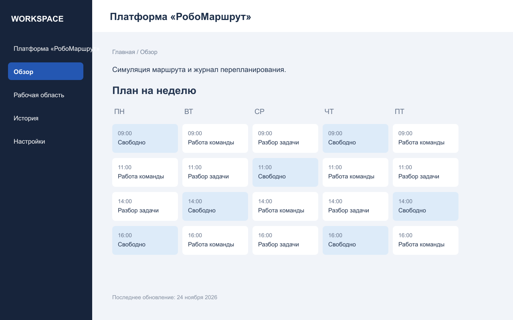

# Платформа «РобоМаршрут»

Полина Сергеева / Робототехника

## Задача

Робот путает временное препятствие и закрытый проход.

## Решение

Симуляция маршрута и журнал перепланирования.

## Основной сценарий

Недостижимая цель приводит к остановке; карты испытаний воспроизводимы.

## Личный вклад

Матрица проверок, регрессионные сценарии и разбор ограничений.

## Следующий этап

Подготовить демонстрацию и документацию для передачи следующей команде.

## Изображения интерфейса

[Портфолио PDF](../documents/portfolios/syn_project_012.pdf) / [Презентация PDF](../documents/presentations/syn_project_012.pdf)
